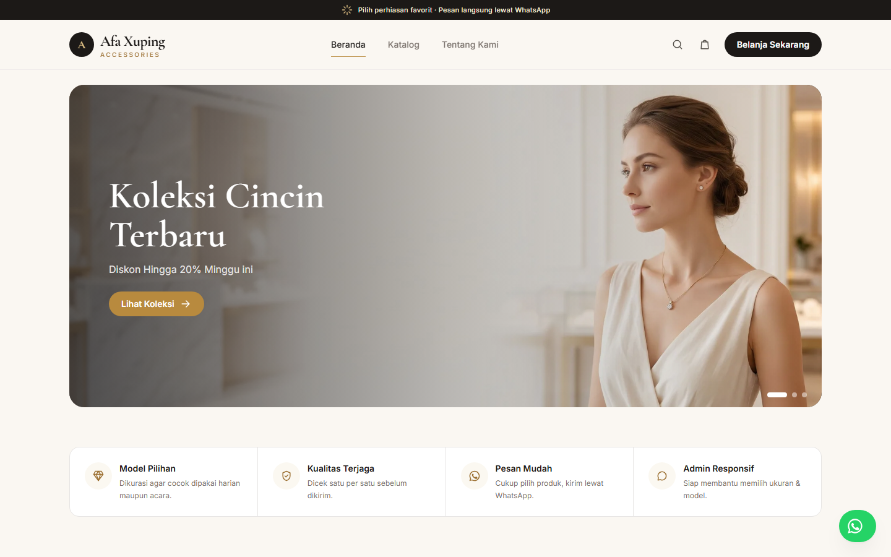
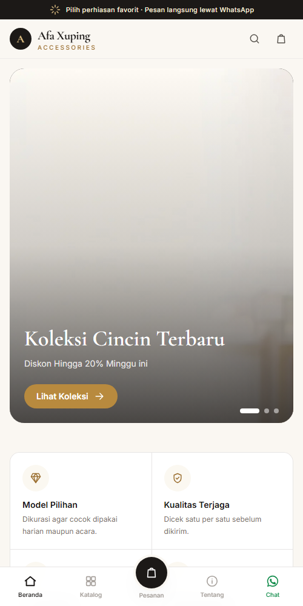
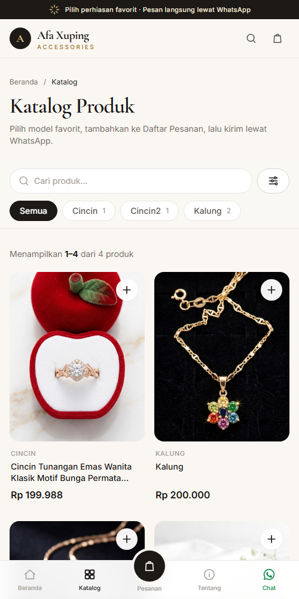
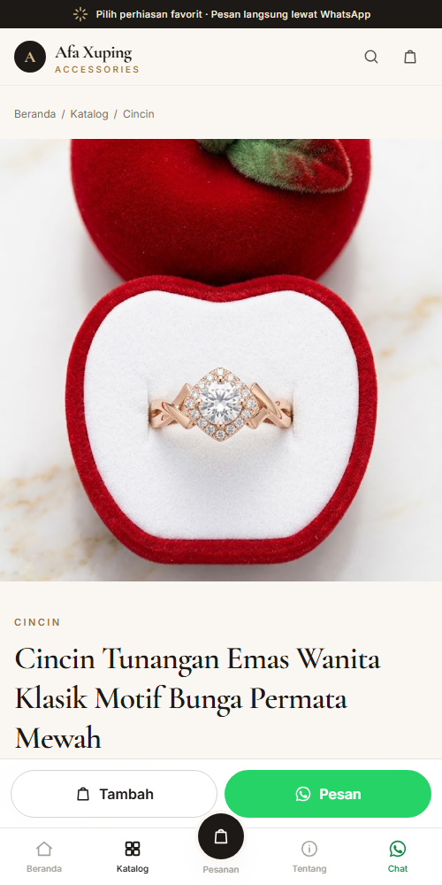
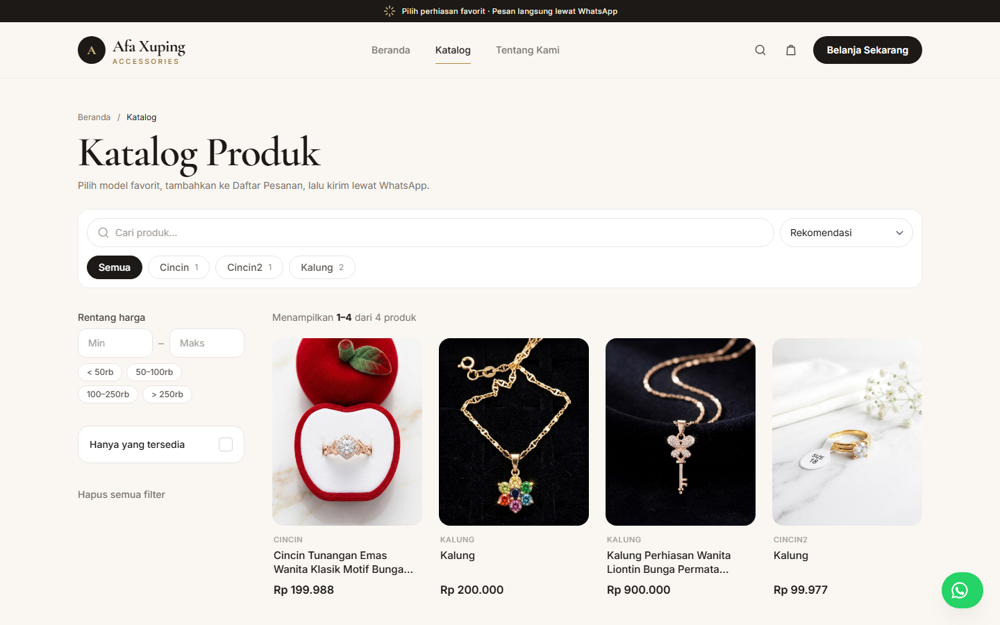
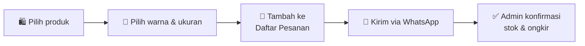

<div align="center">

# ✨ Afa Xuping Accessories

**Katalog perhiasan Xuping yang elegan, dengan pemesanan semudah satu chat WhatsApp.**

[](https://xuping-afa.my.id)


<br>



</div>

---

## 💎 Tentang Proyek

Afa Xuping Accessories adalah website katalog untuk toko perhiasan Xuping. Pengunjung menjelajahi koleksi, memilih **warna dan ukuran**, mengumpulkan beberapa produk ke **Daftar Pesanan**, lalu mengirim semuanya ke admin dalam **satu pesan WhatsApp yang rapi**: tanpa daftar akun, tanpa checkout yang ribet.

Di balik layar, pemilik toko mengelola produk, stok, banner, testimoni, dan seluruh teks website dari satu **dashboard admin**, sekaligus melihat produk mana yang paling sering dipesan.

<div align="center">
<table>
  <tr>
    <td align="center"><br><sub><b>Beranda</b></sub></td>
    <td align="center"><br><sub><b>Katalog & filter</b></sub></td>
    <td align="center"><br><sub><b>Detail produk</b></sub></td>
  </tr>
</table>
<sub>Dirancang <i>mobile-first</i>, lengkap dengan navigasi bawah ala aplikasi.</sub>
</div>

---

## 🛍️ Fitur

### Untuk pembeli

| | Fitur | Keterangan |
|---|---|---|
| 🧺 | **Daftar Pesanan** | Kumpulkan beberapa produk + varian, lalu kirim sekaligus lewat WhatsApp |
| 💍 | **Varian produk** | Pilihan warna (Gold, Silver, Rose Gold) dan ukuran cincin/kalung |
| 🔎 | **Katalog pintar** | Pencarian, filter kategori & harga, "hanya yang tersedia", dan urutan, tanpa muat ulang halaman |
| 🖼️ | **Galeri foto** | Geser foto di HP, zoom layar penuh, dan produk terkait |
| 🏷️ | **Label & diskon** | Baru · Promo · Terlaris, harga coret, dan persentase hemat |
| 📦 | **Status stok** | Tampil "Tersedia" atau "Habis", plus tombol tanya ketersediaan |
| 🔗 | **Siap dibagikan** | Preview link otomatis berisi foto & harga saat dibagikan ke WhatsApp/Facebook |



### Untuk admin

| | Fitur | Keterangan |
|---|---|---|
| 📊 | **Dashboard ringkas** | Produk paling diminati (dari klik WhatsApp) dan daftar yang perlu restok |
| ⚡ | **Edit stok kilat** | Ubah angka stok langsung di tabel, tersimpan otomatis |
| 🗂️ | **Kelola konten** | Produk, kategori, banner slider, dan testimoni pelanggan |
| 💬 | **Pengaturan WhatsApp** | Nomor tujuan dan kalimat pembuka, lengkap dengan pratinjau pesan |
| 🌐 | **Pengaturan website** | Logo, teks beranda & Tentang Kami, kontak, Google Maps, media sosial, SEO |
| 🪶 | **Foto otomatis ringan** | Setiap foto upload diperkecil dan dikonversi ke WebP |
| 👥 | **Hak akses bertingkat** | Superadmin, Owner, dan Admin dengan wewenang berbeda |

---

## 💬 Cara Kerja Pemesanan



Pesan yang diterima admin tersusun otomatis seperti ini:

```text
Halo Afa Xuping Accessories, saya ingin memesan:

1. *Cincin Tunangan Emas Wanita Klasik*
   Ukuran: 7 | Warna: Rose Gold
   1 x Rp 199.988 = Rp 199.988
   https://xuping-afa.my.id/products/...

*Total: Rp 199.988*

Nama: Rina
Alamat: Jl. Mawar No. 3, Denpasar
```

Setiap pesan yang dikirim juga tercatat sebagai "klik WhatsApp", sehingga admin tahu produk mana yang paling diminati.

---

## 🧰 Teknologi

| Lapisan | Teknologi |
|---|---|
| Backend | [Laravel 13](https://laravel.com), PHP 8.3+ |
| Tampilan | Blade, [Tailwind CSS 4](https://tailwindcss.com), [Alpine.js 3](https://alpinejs.dev) |
| Hak akses | [spatie/laravel-permission](https://spatie.be/docs/laravel-permission) |
| Notifikasi | [SweetAlert2](https://sweetalert2.github.io) |
| Font | Cormorant Garamond & Inter (di-host sendiri) |
| Database | MySQL / MariaDB |
| Hosting | InfinityFree |

---

## 👥 Peran Pengguna

| Akses | Superadmin | Owner | Admin |
|---|:---:|:---:|:---:|
| Produk, kategori, banner, testimoni | ✅ | ✅ | ✅ |
| Pengaturan website & WhatsApp | ✅ | ✅ | ❌ |
| Kelola akun admin | ✅ | ✅ | ❌ |
| Kelola akun owner | ✅ | ❌ | ❌ |

> Akun yang masih memiliki produk tidak bisa dihapus supaya produknya tidak ikut hilang. Gunakan **nonaktifkan** sebagai gantinya.

---

## 🚀 Menjalankan di Komputer Lokal

**Kebutuhan:** PHP 8.3+, Composer, Node.js 20+, dan MySQL/MariaDB (misalnya lewat [Laragon](https://laragon.org)).

```bash
# 1. Ambil kode & pasang dependensi
git clone https://github.com/kurniawan-Donn/Xuping-Afa.git
cd Xuping-Afa
composer install
npm install

# 2. Siapkan konfigurasi
cp .env.example .env
php artisan key:generate
```

Buka `.env`, lalu arahkan ke database lokal Anda:

```env
DB_CONNECTION=mysql
DB_HOST=127.0.0.1
DB_PORT=3306
DB_DATABASE=afa_xuping
DB_USERNAME=root
DB_PASSWORD=
```

```bash
# 3. Buat tabel & akun awal, build tampilan, lalu jalankan
php artisan migrate --seed
npm run build
php artisan serve
```

Buka **http://127.0.0.1:8000**, dan panel admin di **http://127.0.0.1:8000/login**.

> ⚠️ Seeder membuat akun bawaan dengan password sederhana (lihat `database/seeders/RolePermissionSeeder.php`). Ganti password-nya sebelum data dibawa ke server.

Foto upload disimpan langsung di `public/storage`, jadi `php artisan storage:link` **tidak diperlukan**.

---

## 🧪 Pengujian

```bash
php vendor/bin/phpunit
```

Test memakai SQLite di memori, jadi tidak menyentuh database lokal Anda. Cakupannya meliputi halaman publik, alur pesanan WhatsApp, CRUD admin, edit stok, hak akses, unggah foto WebP, ganti password, dan sitemap.

---

## 🌍 Deploy

Website berjalan di **InfinityFree**, yang tidak menyediakan SSH, Composer, maupun Node. Semua build dilakukan di lokal lalu diunggah lewat FTP.

Panduan lengkap langkah demi langkah ada di **[DEPLOY-INFINITYFREE.md](DEPLOY-INFINITYFREE.md)**.

Hal yang wajib diingat:
- Gunakan FileZilla dengan transfer type **Binary**.
- Jangan pernah mengedit kode langsung di File Manager hosting. Ubah di lokal, commit, lalu unggah.
- Pastikan `https://xuping-afa.my.id/.env` tetap **tidak bisa diakses** setelah setiap deploy.

---

## 📁 Struktur Singkat

```text
app/
├── Http/Controllers/     # Website, produk, banner, testimoni, pengaturan, pengguna
├── Models/               # Product, Category, Banner, Testimonial, Setting, User
└── Support/ImageUploader.php   # Perkecil & konversi foto ke WebP
resources/
├── css/app.css           # Tema warna gading-emas & komponen UI
├── js/app.js             # Daftar Pesanan, filter live, galeri, form foto
└── views/
    ├── website/          # Halaman publik
    ├── dashboard/        # Panel admin
    └── components/       # Navbar, kartu produk, laci pesanan, ikon
tests/Feature/            # Test storefront, dashboard, dan password
```

---

<div align="center">

Dibuat dengan 💛 oleh **[@kurniawan-Donn](https://github.com/kurniawan-Donn)** untuk **Afa Xuping Accessories**

<sub>Harga dan ketersediaan produk di website dapat berubah sewaktu-waktu.</sub>

</div>
