<!--
Draf isi Buku Panduan Penggunaan. File ini dibaca oleh docs/manual/scripts/build_docx.py.

Konvensi penulisan:
  # BAB n Judul            -> Heading 1 (bab, halaman baru)
  ## n.n Judul             -> Heading 2
  ### n.n.n Judul          -> Heading 3
          -> gambar desktop, nomor gambar diberikan otomatis
  {hp}    -> gambar ponsel (dicetak lebih sempit)
  Tabel: Keterangan        -> keterangan tabel, langsung diikuti tabel Markdown
  > **Catatan:** ...       -> kotak catatan (biru muda)
  > **Perhatian:** ...     -> kotak perhatian (kuning muda)
  Bagian sebelum BAB 1 ditandai dengan "::: nama" sampai ":::".
-->

::: sampul
judul: Buku Panduan Penggunaan
aplikasi: Website Afa Xuping Accessories
klien: Ansoriah Achmadin
versi: 1.0
tanggal: Oktober 2026
penyusun: Dony Kurniawan (Ketua)
url: https://xuping-afa.my.id
:::

::: revisi
Tabel: Riwayat Revisi Dokumen

| Versi | Tanggal | Keterangan | Penyusun |
|---|---|---|---|
| 1.0 | 30 Oktober 2026 | Penyusunan dokumen awal | Dony Kurniawan |
:::

::: pengantar
Buku panduan ini disusun sebagai bagian dari serah terima Website Afa Xuping Accessories kepada Ibu Ansoriah Achmadin. Isinya menjelaskan cara memakai website, baik dari sisi pengunjung toko maupun dari sisi pengelola di panel admin.

Setiap fitur dijelaskan dengan langkah bernomor dan gambar tampilan layar yang diambil langsung dari website. Data pada gambar adalah data contoh, sehingga nama produk, harga, akun, dan nomor kontak dapat berbeda dengan data toko yang sebenarnya.
:::

# BAB 1 Pendahuluan

## 1.1 Latar Belakang

Afa Xuping Accessories adalah toko perhiasan Xuping di Kota Madiun yang menjual cincin, kalung, gelang, dan anting. Sebelum website ini dibuat, katalog produk hanya dibagikan melalui media sosial dan percakapan WhatsApp, sehingga calon pembeli harus bertanya satu per satu tentang harga, ukuran, dan stok.

Website Afa Xuping Accessories menampilkan seluruh katalog dalam satu alamat. Pengunjung dapat memilih produk beserta variannya, lalu mengirim pesanan ke WhatsApp toko dalam format pesan yang sudah tersusun. Pengelola toko memperbarui produk, stok, banner, testimoni, dan pengaturan website melalui panel admin tanpa perlu mengubah kode program.

## 1.2 Tujuan Dokumen

Dokumen ini menjadi acuan bagi pemilik dan pengelola toko dalam menjalankan website sehari-hari. Dokumen juga dapat dipakai untuk memperkenalkan website kepada pengelola baru.

## 1.3 Ruang Lingkup

Panduan ini mencakup seluruh fitur yang tersedia pada website versi saat dokumen disusun, yaitu halaman publik untuk pengunjung, panel admin untuk peran Admin, serta fitur tambahan untuk peran Owner dan Superadmin. Pemasangan server, pengelolaan hosting, dan pengubahan kode program tidak dibahas dalam panduan ini.

## 1.4 Sasaran Pembaca

Pembaca panduan ini adalah pemilik toko dan staf yang diberi akun panel admin. Bab 4 juga dapat dibagikan kepada pelanggan yang membutuhkan petunjuk cara memesan. Pembaca tidak perlu memiliki latar belakang teknis, cukup terbiasa memakai browser di komputer atau ponsel.

## 1.5 Istilah dan Singkatan

Beberapa istilah asing tetap dipakai karena demikianlah yang tertulis di layar website. Daftarnya dapat dilihat pada Tabel 1.1.

Tabel: Istilah dan Singkatan

| Istilah | Penjelasan |
|---|---|
| Admin | Peran pengguna yang mengelola katalog dan konten website. |
| Banner | Gambar besar yang bergeser otomatis di bagian atas beranda. |
| Browser | Aplikasi untuk membuka website, misalnya Google Chrome. |
| Chatbot | Asisten percakapan otomatis bernama Tanya Afa yang menjawab pertanyaan pengunjung. |
| Dashboard | Halaman ringkasan yang pertama kali tampil setelah login. |
| Draf | Status produk yang disimpan tetapi tidak ditampilkan di website. |
| HP | Handphone atau ponsel. Istilah ini dipakai pada beberapa label di panel admin. |
| Login | Masuk ke panel admin dengan email dan kata sandi. |
| Logout | Keluar dari panel admin. |
| Owner | Peran pemilik toko. Dapat mengelola katalog, akun pengguna, dan pengaturan website. |
| Panel admin | Bagian website khusus pengelola, beralamat di /dashboard. |
| Pengunjung | Siapa saja yang membuka website tanpa login. |
| SEO | Search Engine Optimization, yaitu pengaturan agar website mudah ditemukan di Google. |
| Superadmin | Peran dengan hak akses tertinggi, termasuk mengelola akun Owner. |
| URL | Alamat halaman website, misalnya https://xuping-afa.my.id. |
| WebP | Format gambar yang lebih ringan. Foto yang diunggah diubah otomatis ke format ini. |

# BAB 2 Gambaran Umum Sistem

## 2.1 Deskripsi Aplikasi

Website Afa Xuping Accessories terdiri atas dua bagian. Bagian pertama adalah halaman publik di https://xuping-afa.my.id yang berisi beranda, katalog produk, detail produk, dan halaman Tentang Kami. Pesanan tidak dibayar di website, melainkan dikirim sebagai pesan WhatsApp kepada admin toko yang kemudian mengonfirmasi harga, stok, dan ongkos kirim.

Bagian kedua adalah panel admin di https://xuping-afa.my.id/dashboard. Panel ini hanya dapat dibuka setelah login dan dipakai untuk mengelola produk, kategori, banner, testimoni, akun pengguna, chatbot, serta teks dan kontak yang tampil di website. Website juga dilengkapi chatbot Tanya Afa yang menjawab pertanyaan pengunjung berdasarkan data katalog.

## 2.2 Peran Pengguna dan Hak Akses

Website memiliki empat peran. Pengunjung tidak memerlukan akun. Admin, Owner, dan Superadmin masing-masing memiliki akun yang dibuat melalui menu **Pengguna**. Pembagian hak aksesnya tercantum pada Tabel 2.1.

Tabel: Hak Akses Pengguna

| Fitur | Pengunjung | Admin | Owner | Superadmin |
|---|---|---|---|---|
| Melihat beranda, katalog, detail produk, dan Tentang Kami | Ya | Ya | Ya | Ya |
| Mengirim pesanan melalui WhatsApp | Ya | Ya | Ya | Ya |
| Bertanya melalui chatbot Tanya Afa | Ya | Ya | Ya | Ya |
| Login ke panel admin dan melihat Dashboard | Tidak | Ya | Ya | Ya |
| Mengelola produk dan stok | Tidak | Ya | Ya | Ya |
| Mengelola kategori | Tidak | Ya | Ya | Ya |
| Mengelola banner dan testimoni | Tidak | Ya | Ya | Ya |
| Mengubah profil dan kata sandi sendiri | Tidak | Ya | Ya | Ya |
| Mengelola akun Admin | Tidak | Tidak | Ya | Ya |
| Membuat akun Owner baru | Tidak | Tidak | Ya | Ya |
| Mengubah, menonaktifkan, atau menghapus akun Owner lain | Tidak | Tidak | Tidak | Ya |
| Melihat dan mengelola akun Superadmin | Tidak | Tidak | Tidak | Ya |
| Melihat riwayat chatbot | Tidak | Tidak | Ya | Ya |
| Mengubah pengaturan website dan WhatsApp | Tidak | Tidak | Ya | Ya |

## 2.3 Struktur Menu

Menu panel admin terletak di sisi kiri layar dan dikelompokkan seperti pada Tabel 2.2. Kelompok **Pengaturan** hanya tampil untuk Owner dan Superadmin. Di bagian bawah menu terdapat tautan **Lihat Website** serta nama dan peran pengguna yang sedang login.

Tabel: Struktur Menu Panel Admin

| Kelompok | Menu | Fungsi |
|---|---|---|
| Utama | Dashboard | Ringkasan produk, stok, dan minat pembeli |
| Katalog | Produk | Daftar, tambah, ubah, dan hapus produk |
| Katalog | Kategori | Pengelompokan produk |
| Konten Website | Banner | Gambar besar di beranda |
| Konten Website | Testimoni | Ulasan pelanggan |
| Pengaturan | Pengguna | Akun yang dapat login ke panel admin |
| Pengaturan | Chatbot AI | Pemakaian dan riwayat chatbot Tanya Afa |
| Pengaturan | Website & WhatsApp | Teks, gambar, kontak, dan pengaturan chatbot |

Halaman publik memiliki menu **Beranda**, **Katalog**, dan **Tentang Kami** di bagian atas layar. Pada ponsel, menu tersebut digantikan oleh navigasi bawah yang dijelaskan pada subbab 4.8.

# BAB 3 Persyaratan dan Akses Sistem

## 3.1 Kebutuhan Perangkat dan Browser

Website dapat dibuka dari komputer, laptop, tablet, maupun ponsel yang terhubung ke internet. Gunakan browser versi terbaru, yaitu Google Chrome, Mozilla Firefox, Microsoft Edge, atau Safari. Untuk mengelola panel admin, layar komputer atau laptop lebih disarankan karena tabel dan formulirnya lebih lengkap terlihat.

Foto produk dan banner sebaiknya disiapkan dalam format JPG, PNG, atau WebP dengan ukuran file paling besar 5 MB. Ukuran gambar yang disarankan untuk setiap bagian tercantum pada formulir masing-masing.

## 3.2 Mengakses Website

Halaman publik dapat dibuka dengan langkah berikut.

1. Buka browser.
2. Ketik **https://xuping-afa.my.id** pada kolom alamat, lalu tekan Enter.

Panel admin dibuka melalui alamat **https://xuping-afa.my.id/login**. Alamat ini tidak ditampilkan di menu website, sehingga sebaiknya disimpan sebagai bookmark di browser pengelola.

## 3.3 Login dan Logout

### 3.3.1 Login

Login diperlukan untuk membuka panel admin. Akun dibuat oleh Owner atau Superadmin melalui menu **Pengguna**.

1. Buka **https://xuping-afa.my.id/login**.
2. Isi kolom **Email** dengan email akun.
3. Isi kolom **Kata sandi**. Klik ikon mata di ujung kolom untuk melihat kata sandi yang diketik.
4. Centang **Ingat saya** bila komputer tersebut dipakai sendiri, agar tidak perlu login ulang setiap membuka browser.
5. Klik tombol **Masuk**.

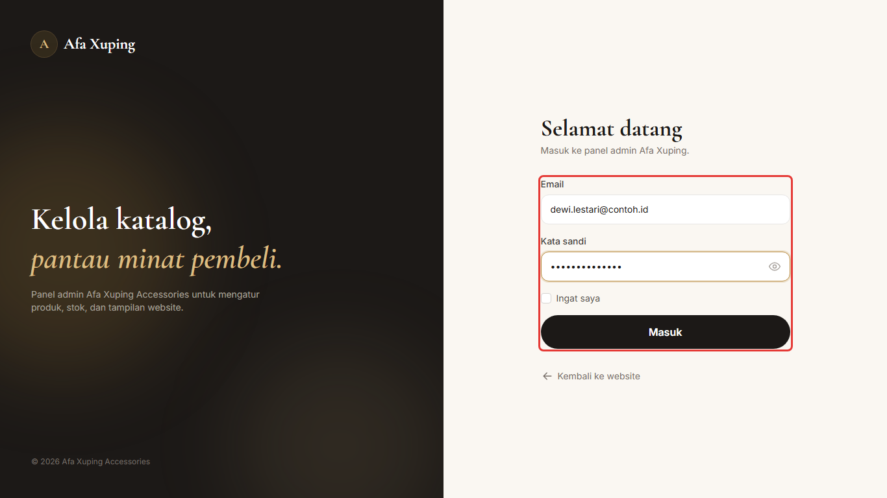

Setelah login berhasil, halaman **Dashboard** tampil. Bila email atau kata sandi salah, atau akun sedang dinonaktifkan, muncul pesan "Email atau password yang Anda masukkan salah."

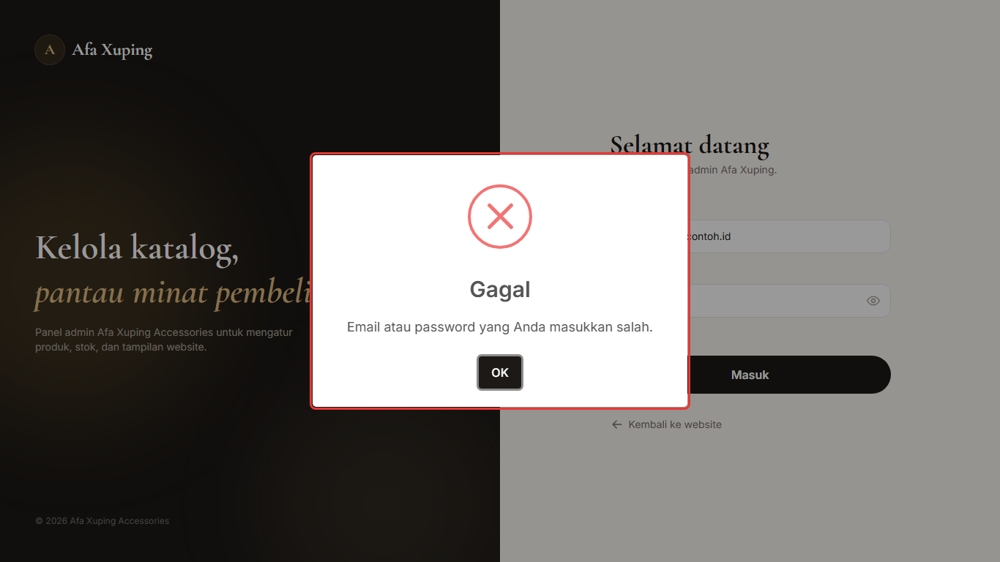

Halaman login juga dapat dibuka dari ponsel dengan tampilan seperti Gambar 3.3.

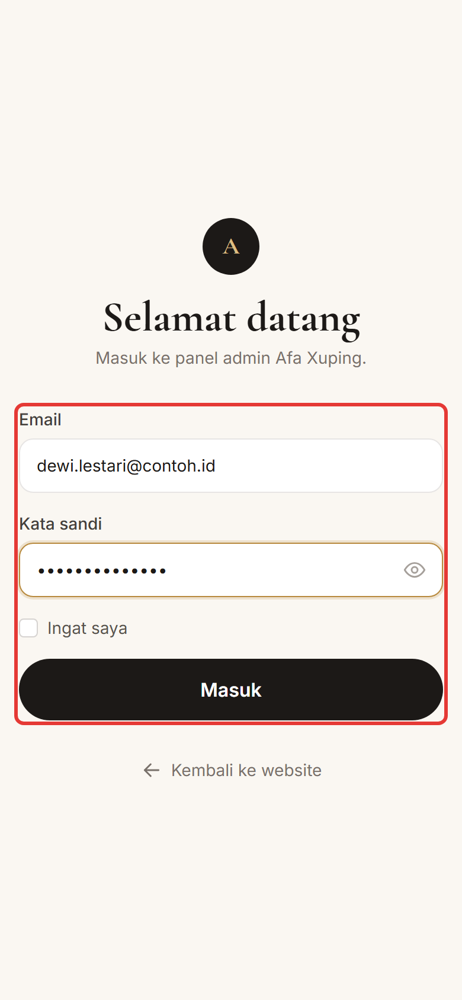{hp}

> **Catatan:** Bila login gagal 10 kali dalam satu menit, website menolak percobaan berikutnya untuk sementara. Tunggu satu menit, lalu coba lagi.

### 3.3.2 Mengenal Tampilan Panel Admin

Panel admin terdiri atas menu di sisi kiri dan area kerja di sisi kanan. Bagian atas area kerja memuat judul halaman, tombol **Produk** untuk menambah produk dengan cepat, dan foto profil pengguna. Pada ponsel, menu kiri disembunyikan dan dibuka dengan ikon garis tiga di kiri atas.

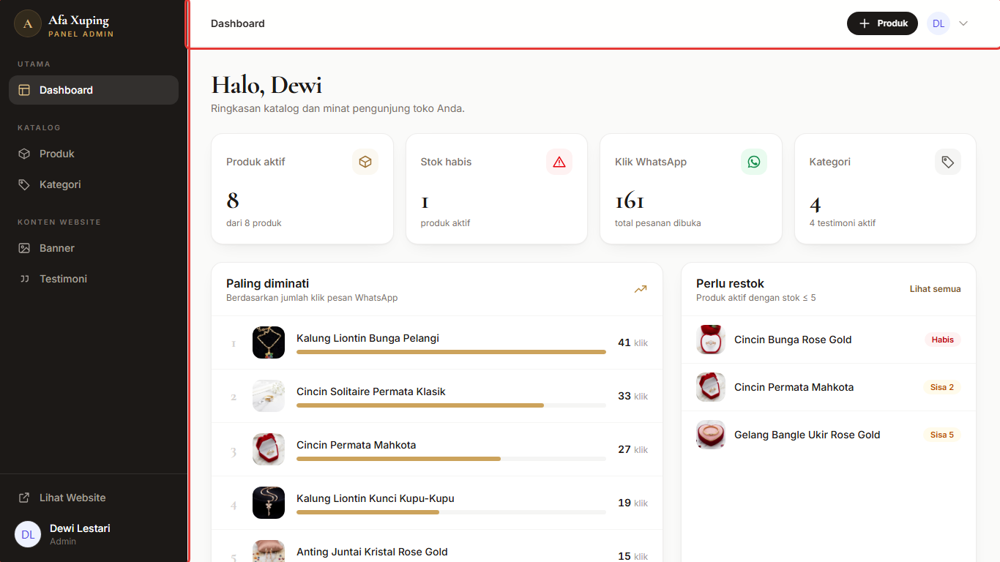

### 3.3.3 Logout

Lakukan logout setiap kali selesai memakai panel admin, terutama pada komputer yang dipakai bersama.

1. Klik foto profil atau inisial nama di kanan atas.
2. Klik **Keluar**.

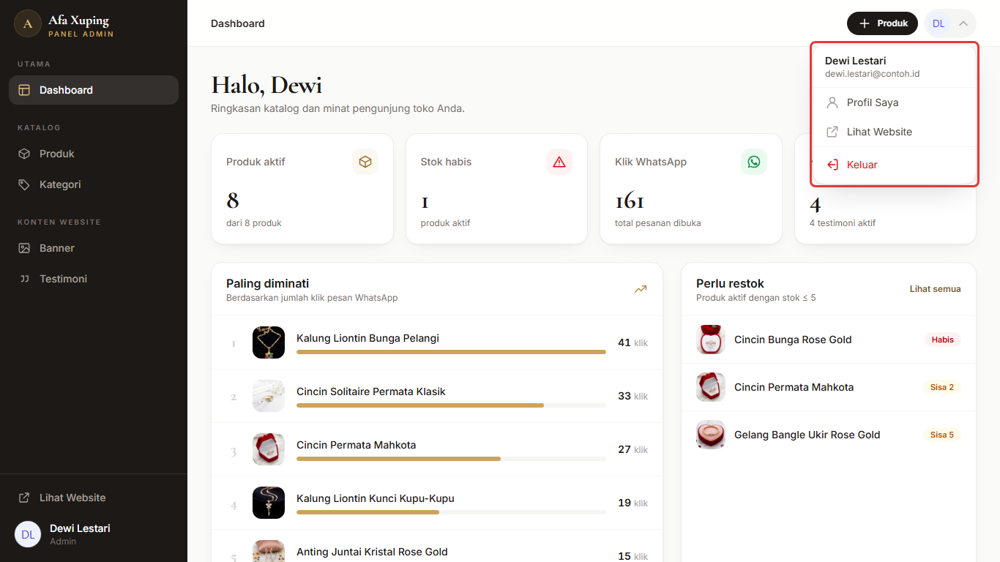

Setelah logout, halaman login tampil kembali dengan pesan "Berhasil logout." Halaman panel admin juga tidak dapat dibuka lagi melalui tombol kembali di browser.

## 3.4 Mengubah Kata Sandi

Website tidak menyediakan fitur lupa kata sandi melalui email. Pengguna yang masih dapat login mengubah kata sandinya sendiri melalui menu profil, seperti dijelaskan pada subbab 5.7. Bila kata sandi terlupa, hubungi bantuan teknis yang tercantum pada Bab 8 untuk mengatur ulang kata sandi.

> **Perhatian:** Owner dan Superadmin tidak dapat melihat atau mengganti kata sandi pengguna lain dari menu **Pengguna**. Kata sandi hanya diisi saat akun dibuat.

# BAB 4 Panduan Pengunjung

Bab ini menjelaskan cara memakai halaman publik website, mulai dari melihat produk sampai mengirim pesanan ke WhatsApp. Tampilan pada ponsel disertakan pada bagian yang berbeda dari tampilan komputer.

## 4.1 Beranda

Beranda adalah halaman pertama yang tampil saat website dibuka. Bagian atasnya menampilkan banner yang bergeser otomatis. Klik tombol **Lihat Koleksi** pada banner untuk membuka halaman yang dituju, atau klik titik di bawah banner untuk berpindah ke banner lain.

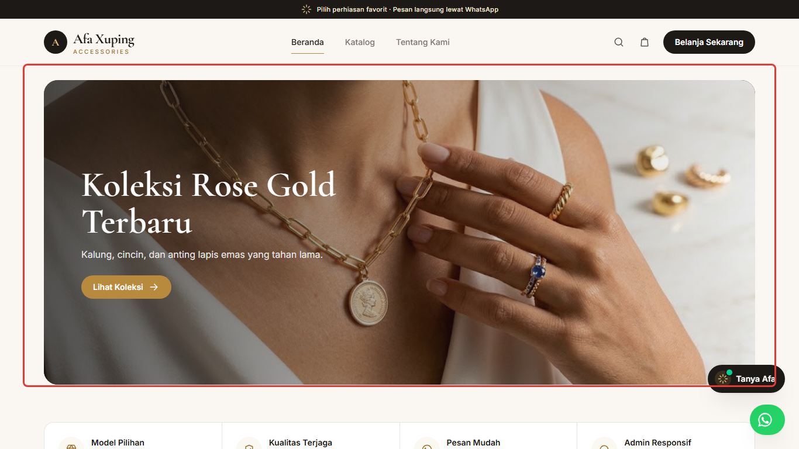

Pada ponsel, banner dapat memakai gambar potret khusus sehingga tidak terpotong. Pengaturannya dijelaskan pada subbab 5.5.

{hp}

Di bawah banner terdapat bagian **Temukan gaya Anda** yang memuat kategori produk beserta jumlah produknya. Klik salah satu kategori untuk membuka katalog yang sudah tersaring.

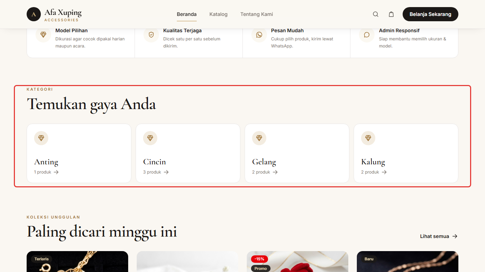

Bagian **Paling dicari minggu ini** menampilkan produk unggulan. Label di sudut foto seperti **Terlaris**, **Promo**, **Baru**, atau **Habis** berasal dari pengaturan produk di panel admin. Di bawahnya terdapat bagian **Tiga langkah, tanpa ribet**, **Koleksi terbaru kami**, dan **Kata mereka** yang berisi testimoni pelanggan.

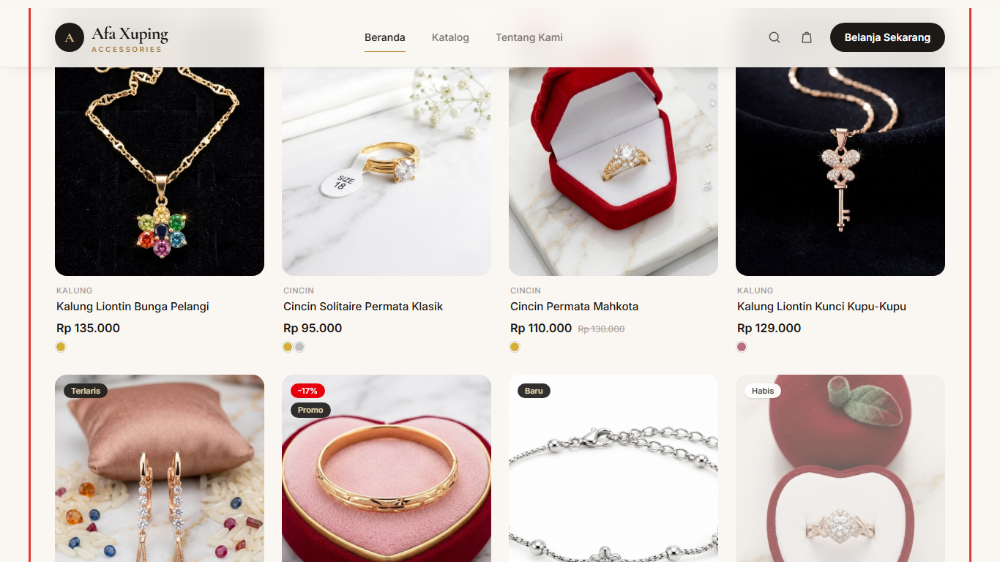

## 4.2 Mencari Produk

Pencarian tersedia di setiap halaman melalui ikon kaca pembesar di bagian atas.

1. Klik ikon kaca pembesar di bagian atas halaman.
2. Ketik nama atau jenis produk, misalnya "cincin".
3. Tekan Enter. Halaman katalog tampil dengan hasil pencarian.

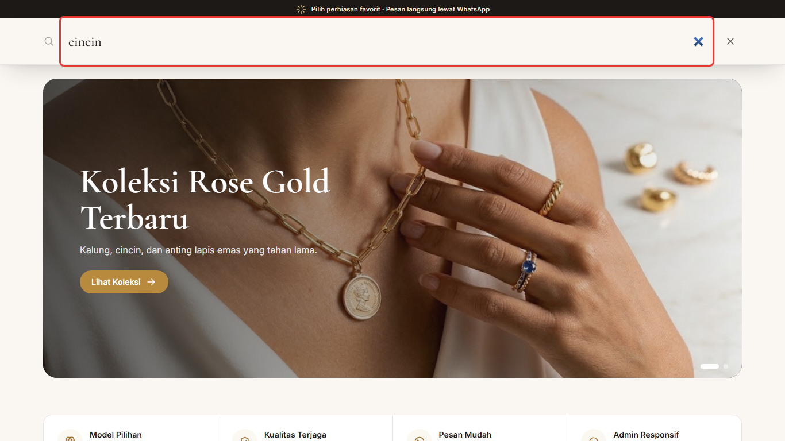

## 4.3 Katalog Produk

Halaman **Katalog Produk** memuat semua produk yang aktif. Hasilnya langsung diperbarui setiap kali pilihan diubah, tanpa perlu memuat ulang halaman.

1. Klik menu **Katalog**.
2. Klik nama kategori, misalnya **Cincin**, untuk menyaring produk. Klik **Semua** untuk menampilkan seluruh produk kembali.
3. Pilih urutan pada daftar pilihan di kanan, yaitu **Rekomendasi**, **Paling diminati**, **Harga terendah**, atau **Harga tertinggi**.
4. Isi **Rentang harga** atau klik salah satu pilihan cepat seperti **50–100rb**.
5. Centang **Hanya yang tersedia** untuk menyembunyikan produk yang stoknya habis.
6. Klik **Hapus semua filter** untuk mengembalikan semua pilihan ke awal.

Setiap halaman katalog memuat 12 produk. Bila hasilnya lebih banyak, nomor halaman tampil di bagian bawah daftar produk.

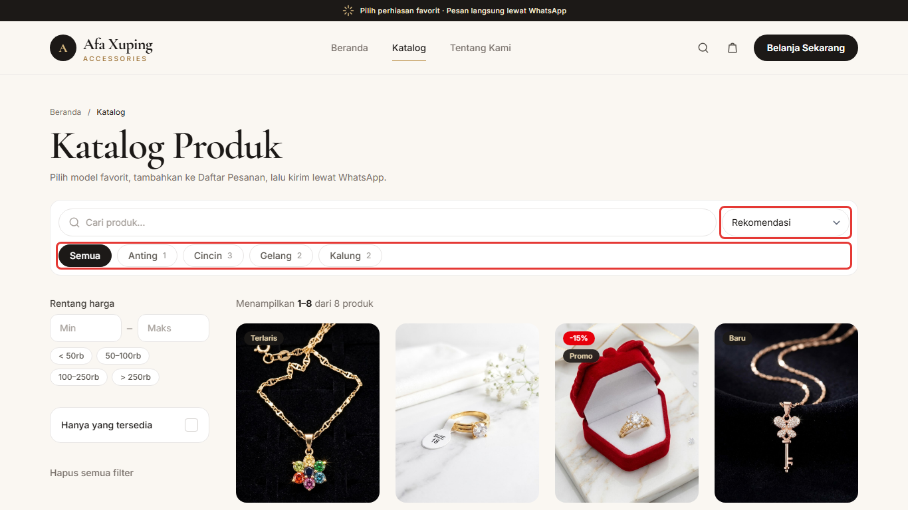

Pada ponsel, pilihan urutan, rentang harga, dan ketersediaan dibuka melalui tombol berikon filter di samping kolom pencarian.

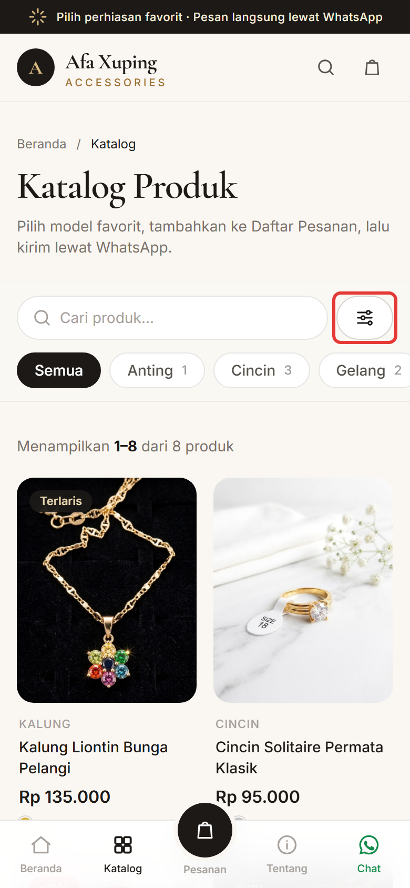{hp}

Setelah pilihan diatur, klik **Tampilkan hasil** untuk menutup panel.

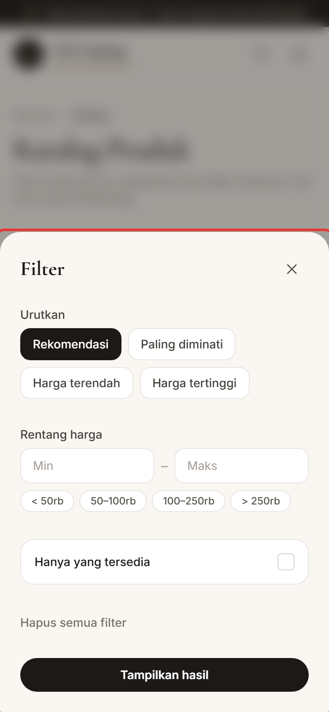{hp}

## 4.4 Detail Produk

Halaman detail menampilkan foto, harga, status ketersediaan, pilihan varian, dan deskripsi produk. Klik foto produk pada katalog untuk membukanya.

1. Geser foto atau klik foto kecil di bawahnya untuk melihat foto lain. Klik foto besar untuk memperbesarnya.
2. Klik pilihan **Warna** bila tersedia.
3. Klik pilihan **Ukuran** bila tersedia.
4. Atur **Jumlah** dengan tombol minus dan plus.

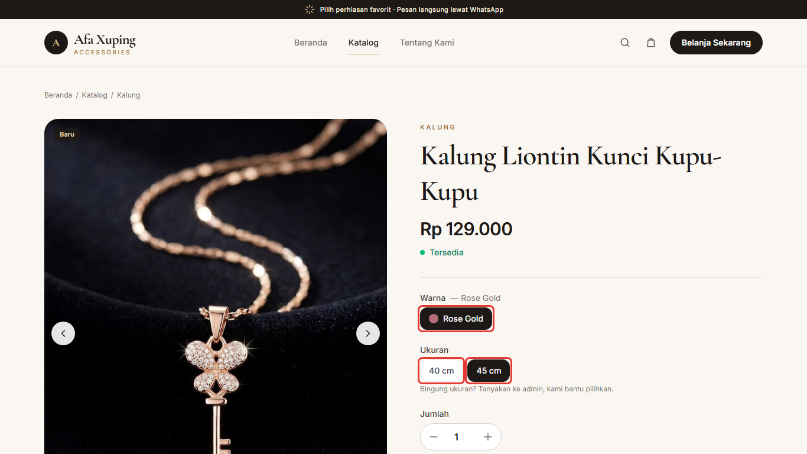

Pilihan warna dan ukuran wajib diklik bila produk memilikinya. Bila belum dipilih, muncul pesan seperti "Pilih ukuran & warna dulu" saat tombol pesan diklik. Bagian **Deskripsi Produk** dan **Cara Pemesanan** dapat dibuka dan ditutup dengan mengklik judulnya. Di bagian bawah halaman, **Mungkin Anda juga suka** menampilkan produk lain dari kategori yang sama.

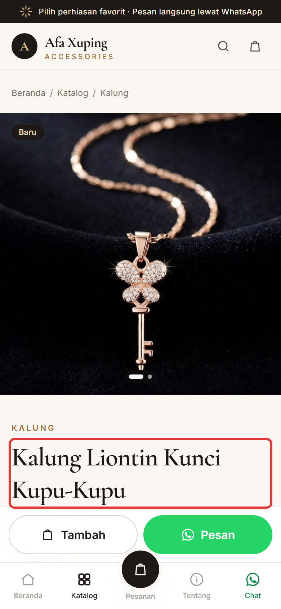{hp}

> **Catatan:** Produk yang stoknya habis tidak menampilkan tombol pesan. Sebagai gantinya tersedia tombol **Tanya Ketersediaan** yang membuka WhatsApp dengan pertanyaan tentang produk tersebut.

## 4.5 Memesan Melalui WhatsApp

Website menyediakan dua cara memesan. Tombol **Pesan Sekarang** langsung membuka WhatsApp berisi satu produk. Tombol **Tambah ke Pesanan** memasukkan produk ke **Daftar Pesanan** agar beberapa produk dapat dikirim sekaligus dalam satu pesan.

### 4.5.1 Memesan Satu Produk

1. Pilih warna, ukuran, dan jumlah seperti pada subbab 4.4.
2. Klik **Pesan Sekarang**.
3. Aplikasi WhatsApp atau WhatsApp Web terbuka dengan pesan berisi nama produk, varian, jumlah, harga, dan tautan produk.
4. Kirim pesan tersebut kepada admin.

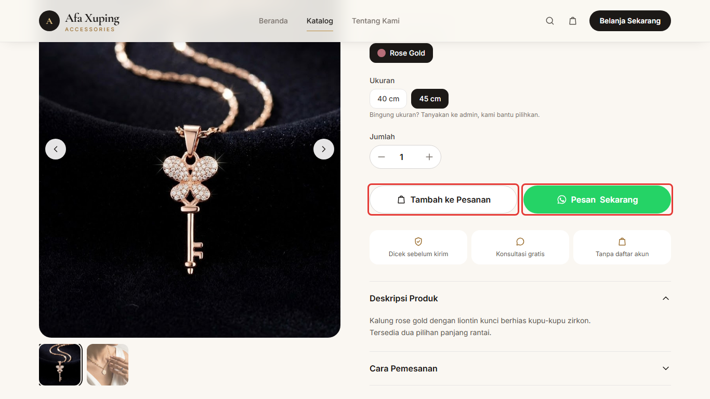

Pada ponsel, kedua tombol tampil di bagian bawah layar dengan nama **Tambah** dan **Pesan**.

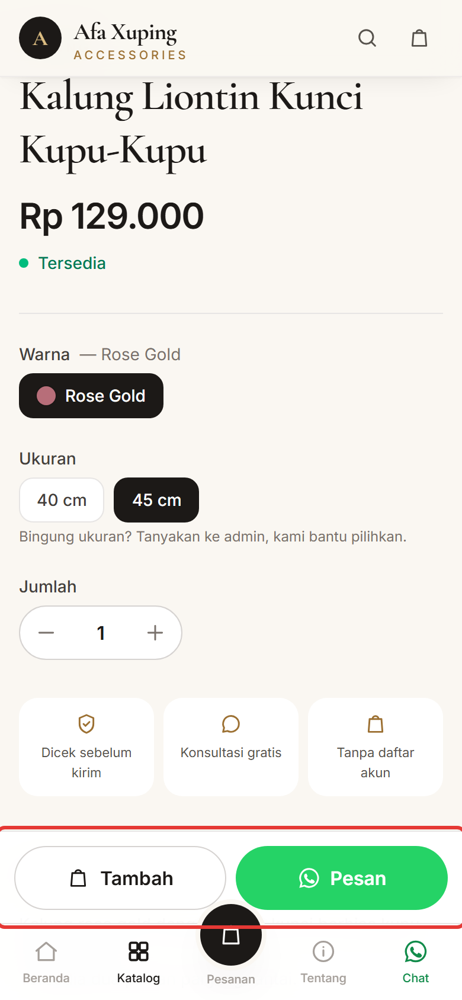{hp}

### 4.5.2 Memesan Beberapa Produk

1. Pilih varian produk, lalu klik **Tambah ke Pesanan**. Muncul pemberitahuan "Ditambahkan ke Daftar Pesanan".
2. Ulangi langkah 1 untuk produk lain.
3. Klik ikon tas belanja di bagian atas halaman. Pada ponsel, klik **Pesanan** di navigasi bawah.
4. Periksa daftar produk. Ubah jumlah dengan tombol minus dan plus, atau klik ikon tempat sampah untuk menghapus produk.
5. Klik **Data pengiriman (opsional)**, lalu isi **Nama penerima**, **Alamat lengkap**, dan **Catatan** bila diperlukan.
6. Klik **Kirim Pesanan via WhatsApp**.
7. Kirim pesan yang terbuka di WhatsApp kepada admin.

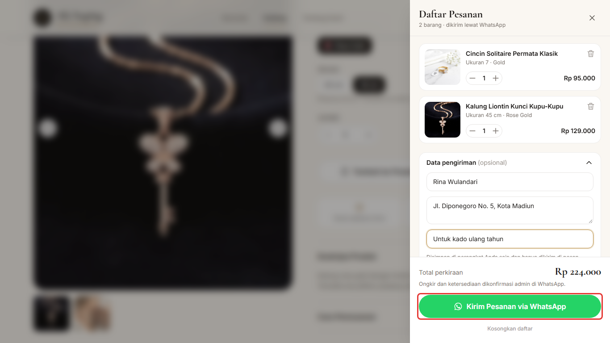

Setelah WhatsApp terbuka, website menanyakan apakah Daftar Pesanan akan dikosongkan. Klik **Ya, kosongkan** bila pesanan sudah terkirim, atau **Simpan dulu** untuk menyimpannya.

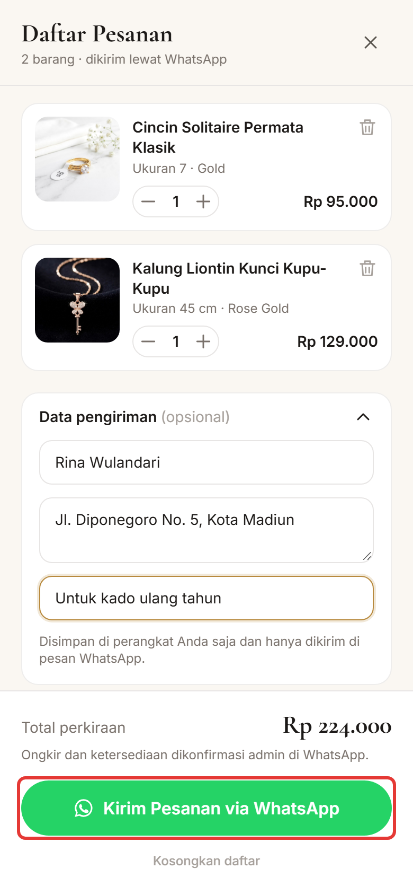{hp}

> **Catatan:** Total pada Daftar Pesanan adalah perkiraan. Ongkos kirim dan ketersediaan barang dikonfirmasi oleh admin melalui WhatsApp. Daftar Pesanan dan data pengiriman hanya tersimpan di browser pengunjung dan tidak dikirim ke website.

## 4.6 Tentang Kami

Halaman **Tentang Kami** berisi profil toko dan testimoni pelanggan. Klik menu **Tentang Kami** untuk membukanya.

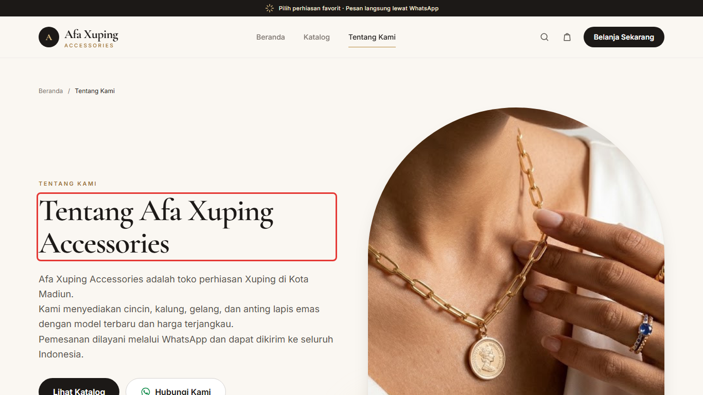

Bagian **Mari terhubung** di bawahnya memuat nomor WhatsApp, email, jam layanan, alamat, dan peta lokasi toko. Klik nomor WhatsApp atau email untuk langsung menghubungi toko, atau klik **Buka di Maps** untuk membuka petunjuk arah di Google Maps.

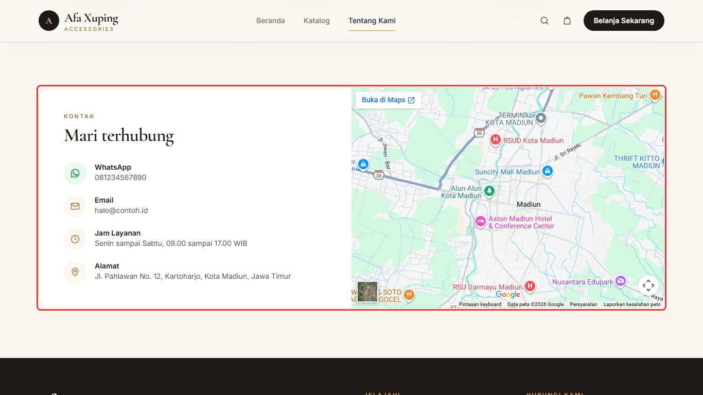

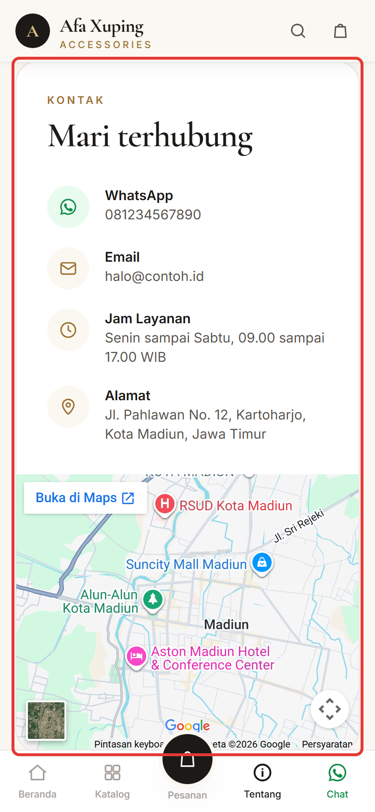{hp}

## 4.7 Bertanya Melalui Tanya Afa

Tanya Afa adalah chatbot yang menjawab pertanyaan seputar produk, harga, ukuran, dan cara memesan berdasarkan katalog toko. Tombolnya tampil di kanan bawah setiap halaman publik selama fitur ini diaktifkan di pengaturan.

1. Klik tombol **Tanya Afa** di kanan bawah layar.

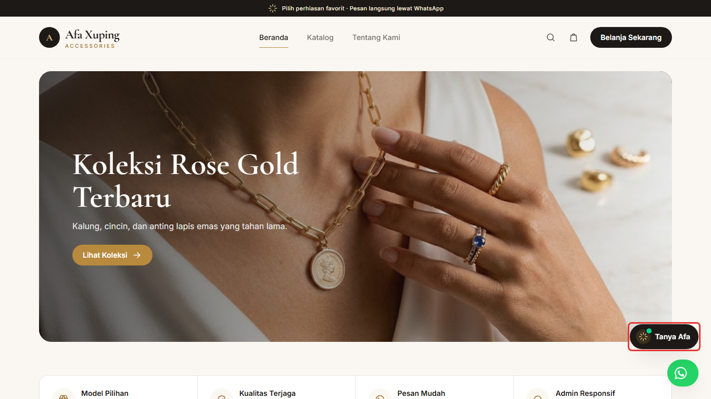

2. Ketik pertanyaan pada kolom **Tulis pertanyaan…** di bagian bawah jendela chat.
3. Tekan Enter atau klik tombol kirim berikon panah.
4. Tunggu jawaban. Bila ada produk yang sesuai, jawaban disertai kartu produk. Klik **Pilih** pada kartu untuk membuka halaman produk tersebut.

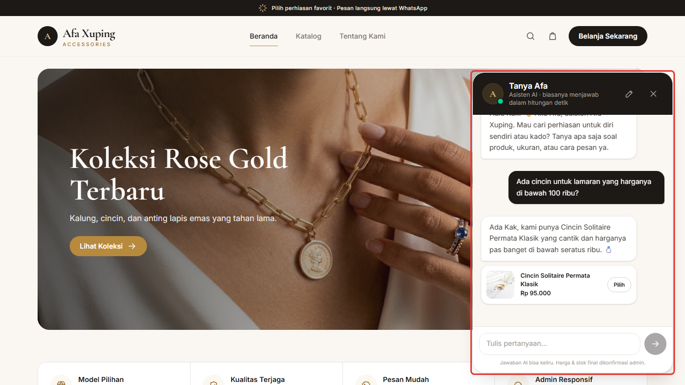

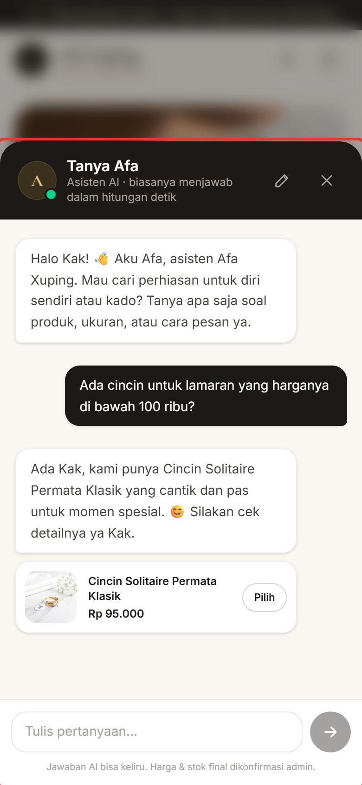{hp}

Untuk memulai percakapan dari awal, klik ikon **Mulai ulang** di samping tombol tutup pada bagian atas jendela chat. Bila chatbot tidak dapat membantu, jawaban disertai tombol **Chat admin di WhatsApp**.

> **Catatan:** Jawaban chatbot dibuat oleh kecerdasan buatan dan bisa keliru. Harga dan stok final tetap dikonfirmasi oleh admin. Percakapan hanya tersimpan selama tab browser masih terbuka.

## 4.8 Navigasi pada Ponsel

Pada ponsel, bagian bawah layar memuat lima menu tetap, yaitu **Beranda**, **Katalog**, **Pesanan**, **Tentang**, dan **Chat**. Menu **Pesanan** membuka Daftar Pesanan, sedangkan **Chat** membuka WhatsApp toko.

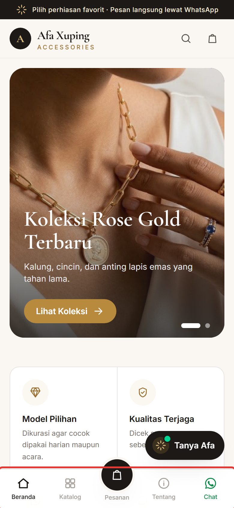{hp}

# BAB 5 Panduan Admin

Bab ini berlaku untuk semua peran yang dapat login, yaitu Admin, Owner, dan Superadmin. Fitur khusus Owner dan Superadmin dijelaskan pada Bab 6.

## 5.1 Dashboard

Dashboard tampil setelah login dan merangkum kondisi katalog. Baris paling atas memuat empat angka, yaitu **Produk aktif**, **Stok habis**, **Klik WhatsApp**, dan **Kategori**. Klik salah satu kotak untuk membuka daftar yang terkait.

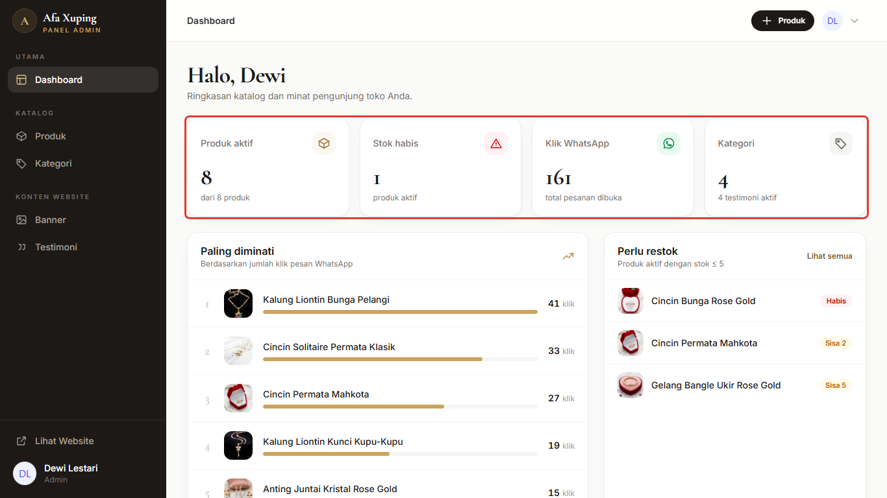

Bagian **Paling diminati** mengurutkan produk berdasarkan jumlah klik tombol pesan WhatsApp. Bagian **Perlu restok** menampilkan produk aktif dengan stok 5 atau kurang, sehingga stok dapat segera ditambah. Di bawahnya terdapat daftar **Produk terbaru**.

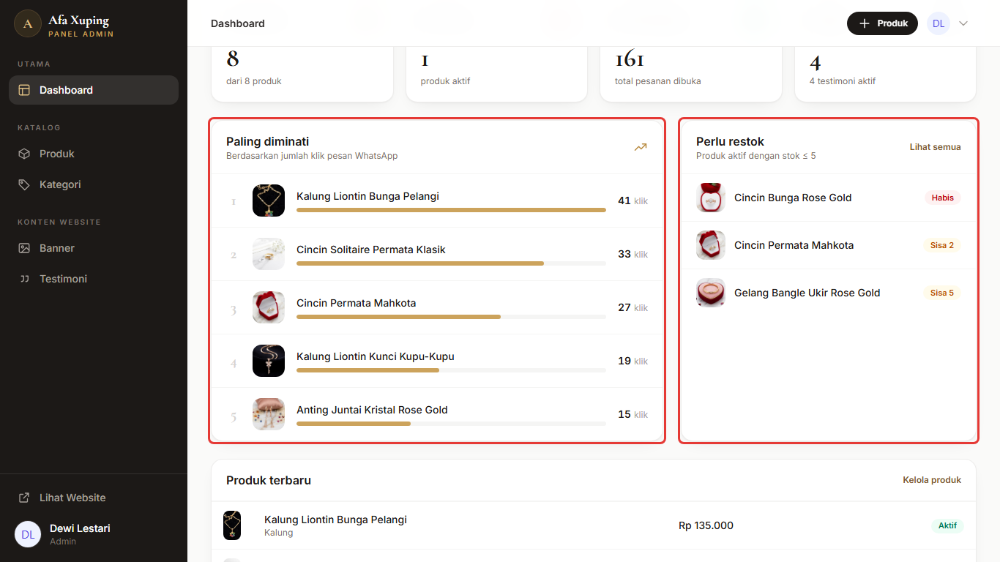

Panel admin juga dapat dipakai dari ponsel. Menu kiri dibuka dengan ikon garis tiga di kiri atas.

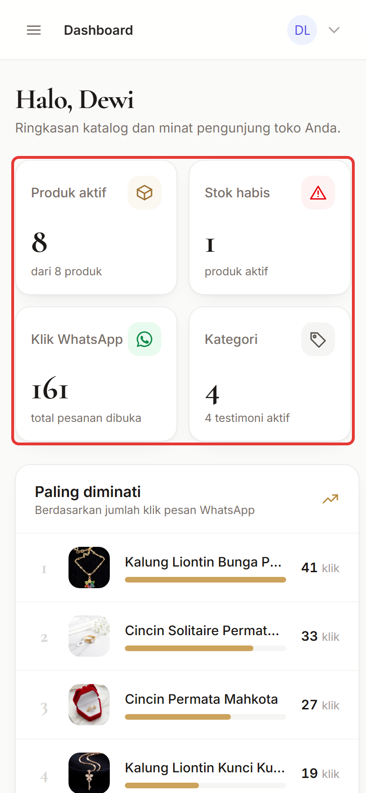{hp}

## 5.2 Mengelola Produk

### 5.2.1 Melihat dan Mencari Produk

Menu **Produk** menampilkan semua produk beserta harga, stok, dan statusnya.

1. Klik menu **Produk**.
2. Ketik nama produk pada kolom **Cari nama produk…** untuk mencari.
3. Pilih kategori, status (**Aktif** atau **Draf**), atau kondisi stok (**Stok menipis** atau **Stok habis**) pada daftar pilihan di sebelahnya.
4. Pilih jumlah baris per halaman, yaitu **10 / hal**, **25 / hal**, atau **50 / hal**.

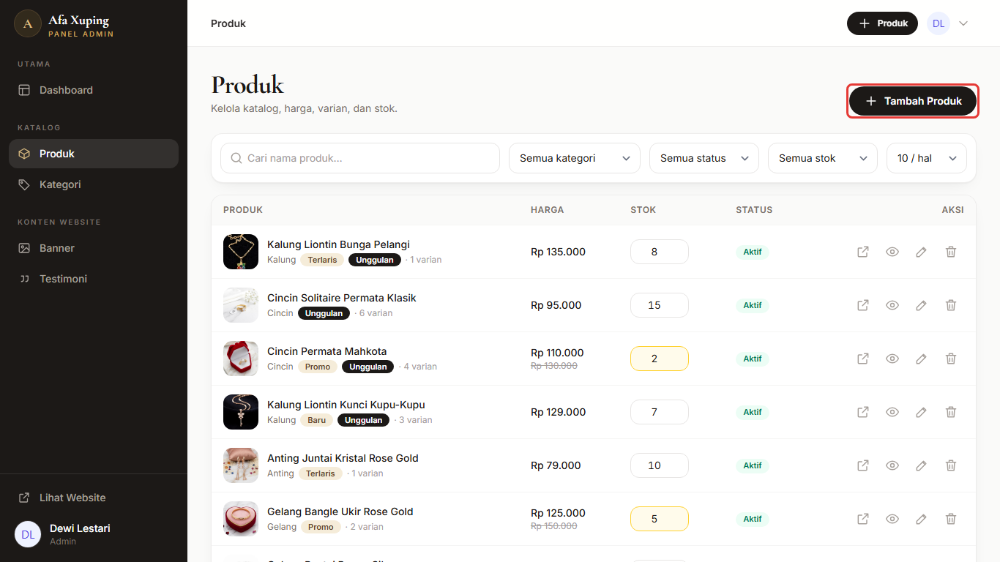

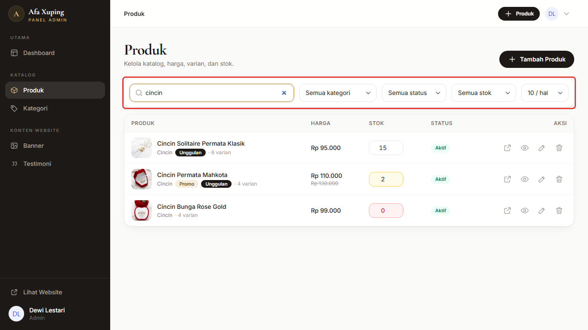

Kolom **Aksi** di ujung kanan memuat empat ikon, yaitu **Lihat di website**, **Detail**, **Edit**, dan **Hapus**.

### 5.2.2 Mengubah Stok dengan Cepat

Stok dapat diubah langsung dari daftar produk tanpa membuka formulir.

1. Klik angka pada kolom **Stok** di baris produk.
2. Ketik jumlah stok yang baru.
3. Tekan Enter atau klik di luar kolom. Muncul pemberitahuan "Stok disimpan" di kanan atas.

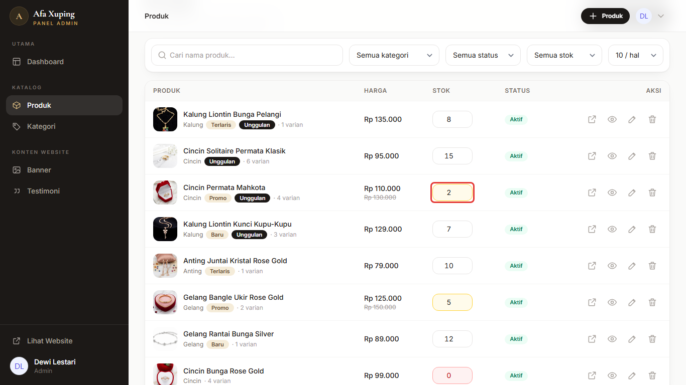

Kolom stok berwarna merah bila stok habis dan berwarna kuning bila stok 5 atau kurang. Website hanya menampilkan "Tersedia" atau "Habis" kepada pengunjung, tidak menampilkan angka stok.

### 5.2.3 Menambah Produk

1. Klik tombol **Tambah Produk** pada halaman daftar produk, atau tombol **Produk** di kanan atas panel.
2. Isi bagian **Informasi produk**, yaitu **Nama produk**, **Kategori**, dan **Deskripsi**.

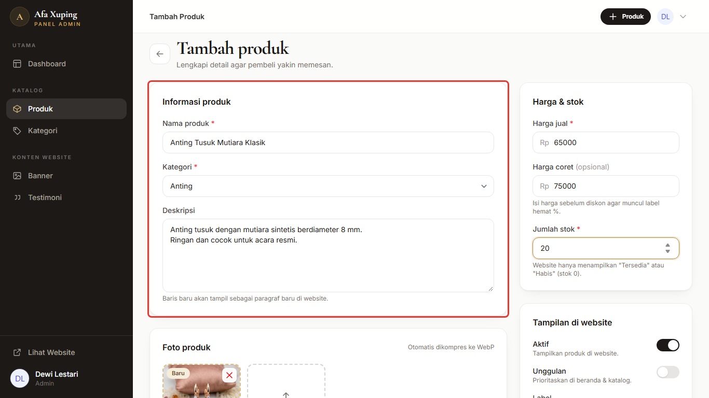

3. Klik kotak **Tambah foto** pada bagian **Foto produk**, lalu pilih satu atau beberapa foto. Foto pertama dipakai sebagai sampul.

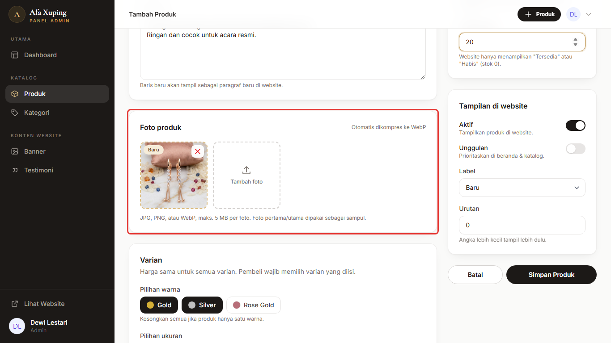

4. Klik warna yang tersedia pada **Pilihan warna**, lalu isi **Pilihan ukuran** dengan ukuran yang dipisahkan koma, misalnya "6, 7, 8, 9" untuk cincin atau "40 cm, 45 cm" untuk kalung.

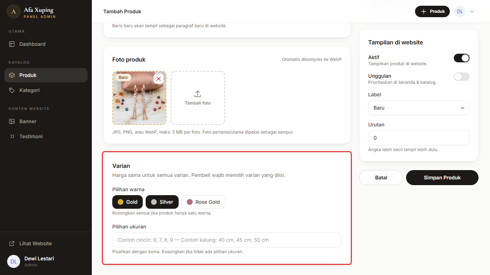

5. Isi **Harga jual**, **Harga coret** bila produk sedang diskon, dan **Jumlah stok**.

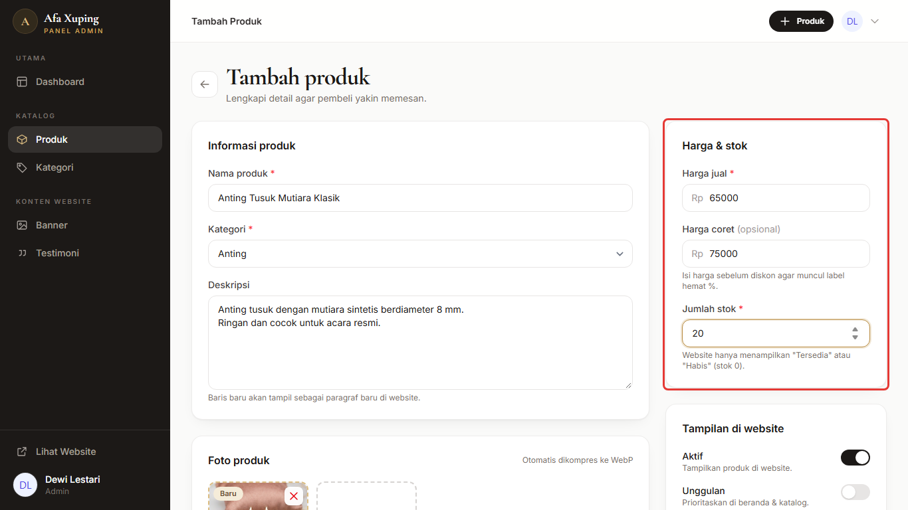

6. Atur bagian **Tampilan di website**, lalu klik **Simpan Produk**.

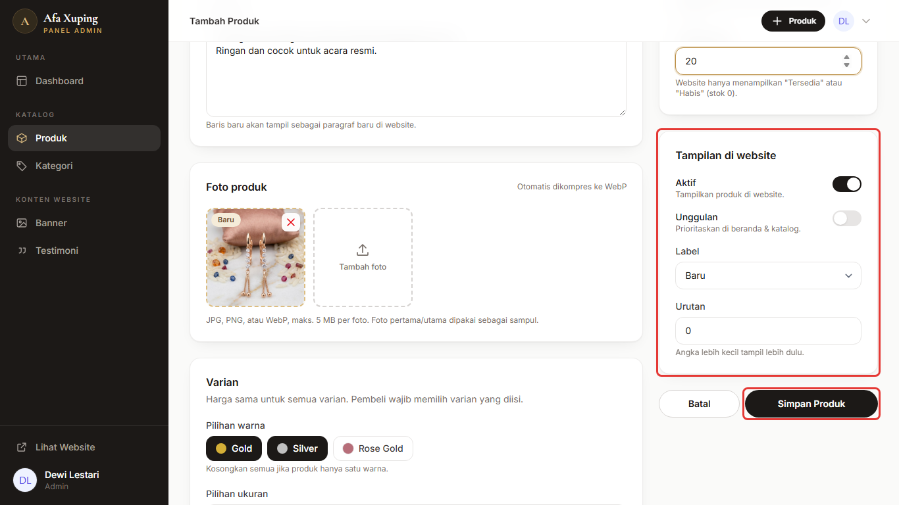

Setelah tersimpan, halaman daftar produk tampil dengan pesan "Produk berhasil ditambahkan." Penjelasan setiap kolom formulir tercantum pada Tabel 5.1.

Tabel: Isian Formulir Produk

| Kolom | Keterangan | Wajib |
|---|---|---|
| Nama produk | Nama yang tampil di katalog, paling banyak 255 karakter. | Ya |
| Kategori | Kategori tempat produk dikelompokkan. | Ya |
| Deskripsi | Bahan, ukuran detail, dan tips perawatan. Baris baru tampil sebagai paragraf baru. | Tidak |
| Foto produk | JPG, PNG, atau WebP, paling besar 5 MB per foto. Diubah otomatis ke WebP. | Tidak |
| Pilihan warna | Gold, Silver, atau Rose Gold. Kosongkan bila produk hanya satu warna. | Tidak |
| Pilihan ukuran | Ukuran dipisahkan koma. Kosongkan bila tidak ada pilihan ukuran. | Tidak |
| Harga jual | Harga dalam rupiah tanpa titik. Berlaku untuk semua varian. | Ya |
| Harga coret | Harga sebelum diskon. Harus lebih besar dari harga jual. Label diskon persen tampil otomatis. | Tidak |
| Jumlah stok | Angka 0 sampai 999.999. Stok 0 membuat produk berstatus Habis. | Ya |
| Aktif | Bila dimatikan, produk berstatus Draf dan tidak tampil di website. | Tidak |
| Unggulan | Bila dinyalakan, produk diprioritaskan di beranda dan katalog. | Tidak |
| Label | Tanpa label, Baru, Promo, atau Terlaris. Tampil di sudut foto produk. | Tidak |
| Urutan | Angka lebih kecil tampil lebih dulu. | Tidak |

Bila ada kolom wajib yang kosong atau isinya tidak sesuai, muncul pesan "Periksa kembali" dan kolom yang bermasalah ditandai merah beserta keterangannya, misalnya "Nama wajib diisi."

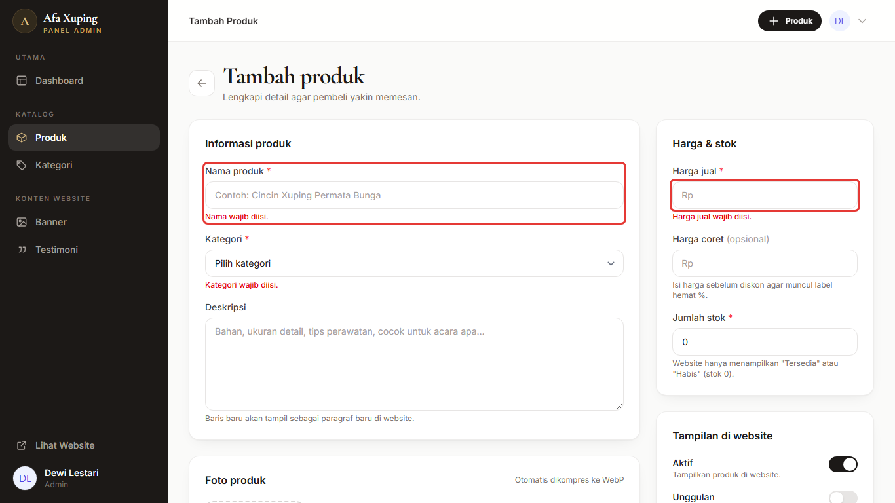

### 5.2.4 Mengubah Produk dan Foto

1. Klik ikon **Edit** pada baris produk.
2. Ubah isian yang diperlukan.
3. Pada bagian **Foto produk**, klik **Jadikan utama** pada foto yang akan dijadikan sampul, atau klik ikon silang untuk menandai foto yang akan dihapus. Foto sampul ditandai label **Utama**.
4. Klik **Simpan Perubahan**.

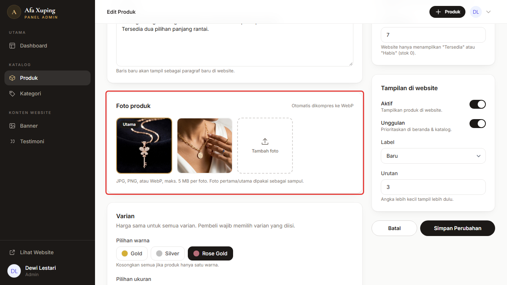

Setelah tersimpan, muncul pesan "Produk berhasil diperbarui."

### 5.2.5 Melihat Detail Produk

Klik ikon **Detail** untuk melihat ringkasan produk, termasuk jumlah klik WhatsApp, pembuat produk, dan waktu terakhir diubah. Dari halaman ini produk dapat dibuka di website melalui tombol **Lihat di website** atau diubah melalui tombol **Edit**.

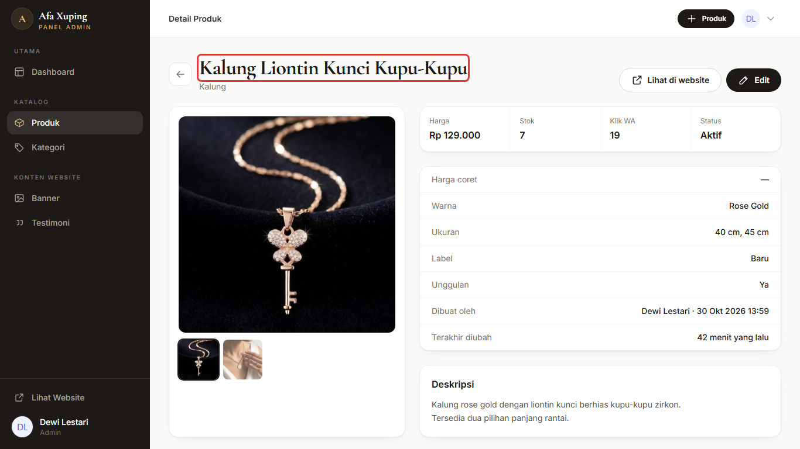

### 5.2.6 Menghapus Produk

1. Klik ikon **Hapus** pada baris produk.
2. Baca pesan konfirmasi yang muncul.
3. Klik **Ya, lanjutkan** untuk menghapus, atau **Batal** untuk membatalkan.

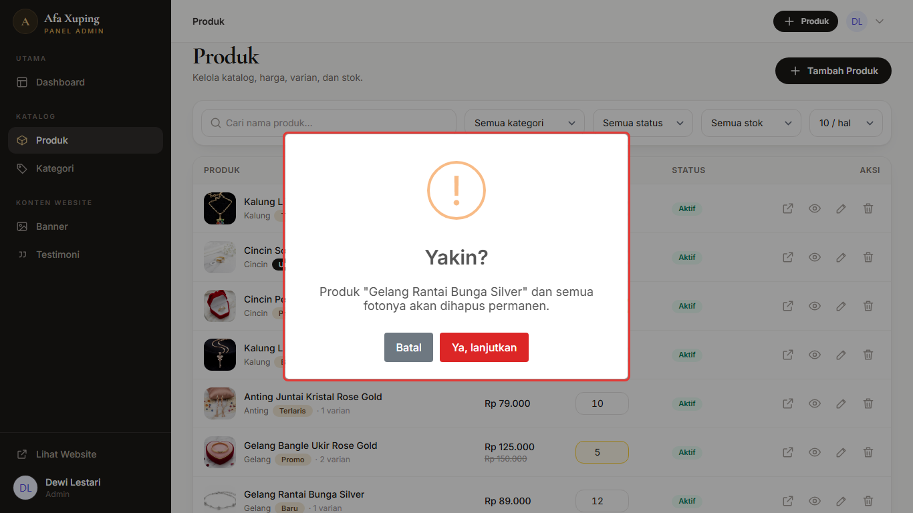

> **Perhatian:** Produk yang dihapus beserta semua fotonya tidak dapat dikembalikan. Bila produk hanya ingin disembunyikan sementara, matikan sakelar **Aktif** pada formulir produk.

## 5.3 Mengelola Kategori

Kategori dipakai untuk mengelompokkan produk di katalog dan beranda. Menu **Kategori** menampilkan nama, deskripsi, dan jumlah produk setiap kategori.

1. Klik menu **Kategori**.
2. Klik **Tambah Kategori**.

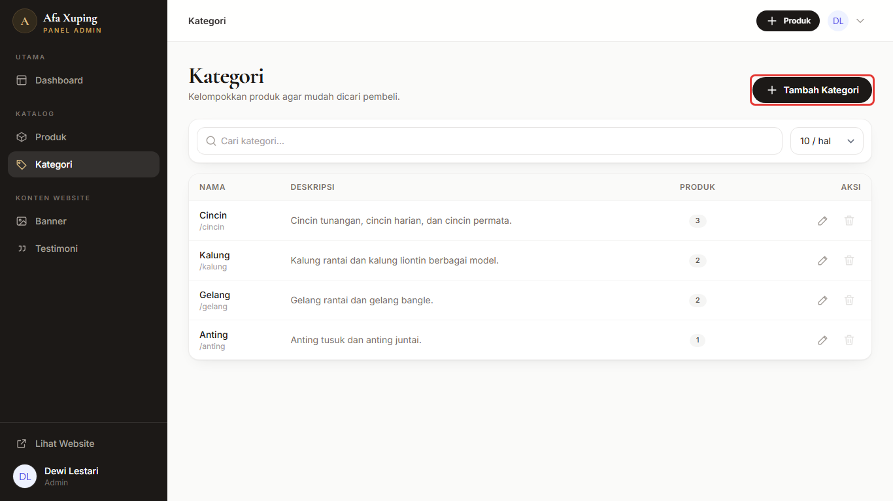

3. Isi **Nama kategori** dan **Deskripsi** bila perlu.
4. Klik **Simpan**. Muncul pesan "Kategori berhasil ditambahkan."

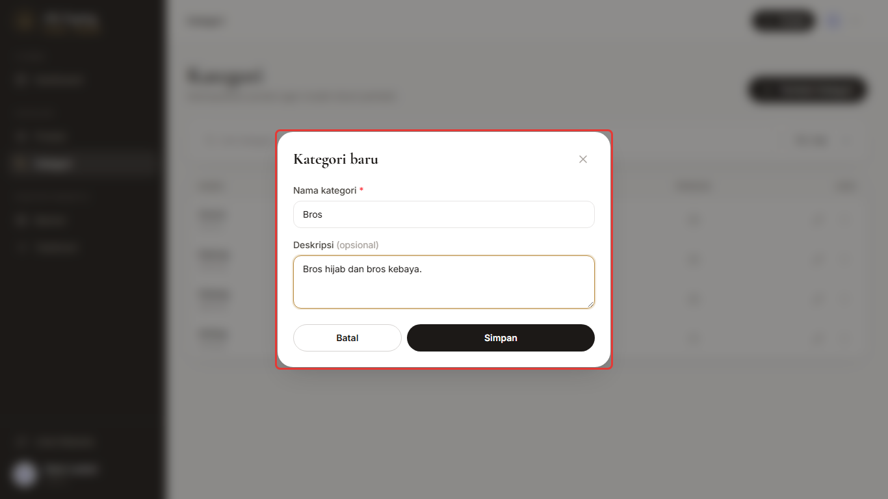

Kolom **Cari kategori…** di atas tabel dipakai untuk mencari kategori berdasarkan nama. Untuk mengubah kategori, klik ikon pensil pada barisnya, ubah isian, lalu klik **Simpan**. Nama kategori tidak boleh sama dengan kategori lain.

> **Perhatian:** Kategori yang masih berisi produk tidak dapat dihapus. Pindahkan atau hapus produknya terlebih dahulu.

## 5.4 Mengelola Testimoni

Testimoni adalah ulasan pelanggan yang tampil di beranda dan halaman Tentang Kami. Setiap kartu pada menu **Testimoni** menampilkan rating, isi ulasan, nama pelanggan, kota, dan status **Tampil**.

1. Klik menu **Testimoni**.
2. Klik **Tambah Testimoni**.

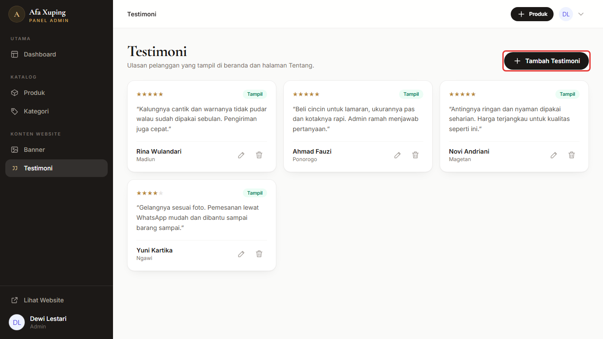

3. Isi **Nama pelanggan** dan **Kota**.
4. Klik bintang pada **Rating** sesuai nilai ulasan.
5. Isi **Isi testimoni**.
6. Atur **Urutan** dan sakelar **Tampilkan**.
7. Klik **Simpan Testimoni**. Muncul pesan "Testimoni berhasil ditambahkan."

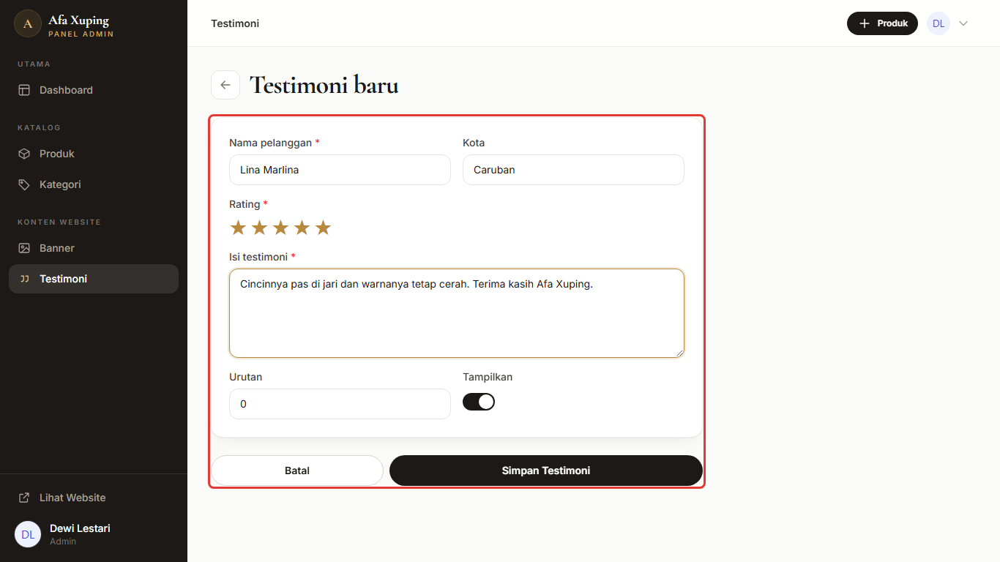

Tabel: Isian Formulir Testimoni

| Kolom | Keterangan | Wajib |
|---|---|---|
| Nama pelanggan | Paling banyak 100 karakter. | Ya |
| Kota | Kota asal pelanggan, paling banyak 100 karakter. | Tidak |
| Rating | Satu sampai lima bintang. | Ya |
| Isi testimoni | Paling banyak 1.000 karakter. | Ya |
| Urutan | Angka lebih kecil tampil lebih dulu. | Tidak |
| Tampilkan | Bila dimatikan, testimoni disimpan tetapi tidak tampil di website. | Tidak |

Testimoni diubah atau dihapus melalui ikon pensil dan ikon tempat sampah di kartu testimoni.

## 5.5 Mengelola Banner

Banner adalah gambar besar yang bergeser otomatis di bagian atas beranda. Bila tidak ada banner aktif, beranda menampilkan judul dan gambar hero dari menu **Website & WhatsApp**.

### 5.5.1 Melihat Daftar Banner

Klik menu **Banner** untuk melihat semua banner. Setiap kartu menampilkan status **Aktif** atau **Nonaktif**, urutan, dan link tujuan. Gambar kecil di kanan bawah kartu menandakan banner tersebut memiliki gambar khusus ponsel, sedangkan label **Tanpa gambar HP** menandakan sebaliknya.

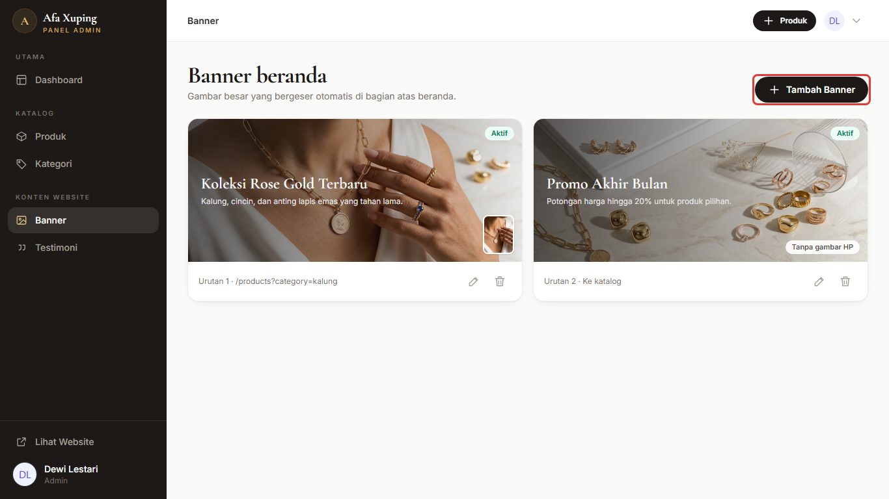

### 5.5.2 Menambah atau Mengubah Banner

1. Klik **Tambah Banner**, atau klik ikon pensil pada banner yang akan diubah.
2. Klik area **Gambar desktop**, lalu pilih gambar lanskap. Ukuran yang disarankan adalah 1920 × 820 piksel.

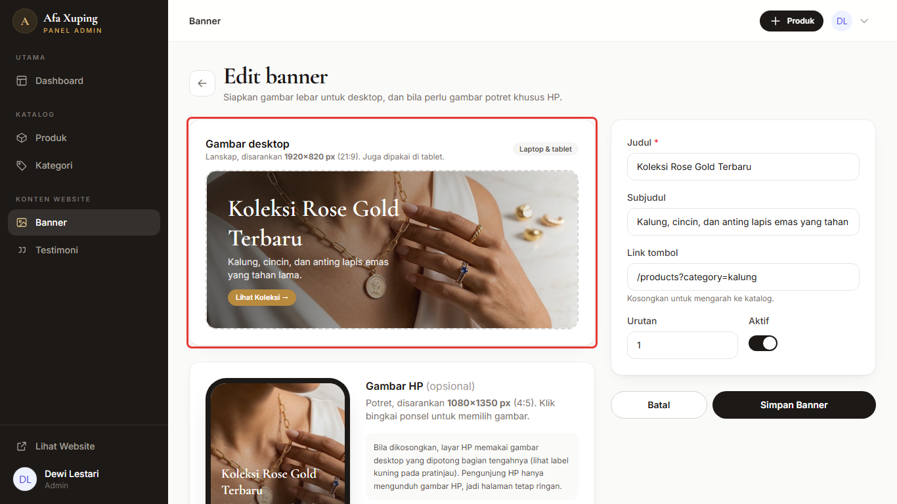

3. Bila diperlukan, klik bingkai ponsel atau tombol **Pilih gambar HP**, lalu pilih gambar potret berukuran 1080 × 1350 piksel.
4. Nyalakan sakelar **Sembunyikan teks di HP** bila gambar ponsel sudah berisi tulisan sendiri.

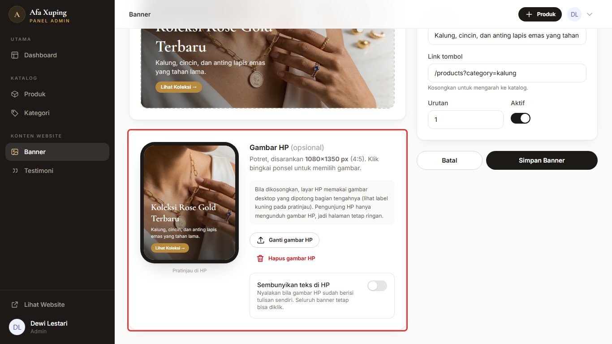

5. Isi **Judul**, **Subjudul**, **Link tombol**, dan **Urutan**, lalu atur sakelar **Aktif**.
6. Klik **Simpan Banner**.

Pratinjau di formulir langsung berubah mengikuti gambar dan teks yang diisi. Bila **Gambar HP** dikosongkan, ponsel memakai bagian tengah gambar desktop dan pratinjau ponsel diberi label kuning **Dari gambar desktop**. Untuk melepas gambar ponsel yang sudah ada, klik **Hapus gambar HP** sebelum menyimpan.

Tabel: Isian Formulir Banner

| Kolom | Keterangan | Wajib |
|---|---|---|
| Gambar desktop | Gambar lanskap untuk komputer dan tablet. JPG, PNG, atau WebP, paling besar 5 MB. | Ya, saat banner baru |
| Gambar HP | Gambar potret khusus ponsel dengan ketentuan file yang sama. | Tidak |
| Sembunyikan teks di HP | Menyembunyikan judul dan tombol pada ponsel. Seluruh banner tetap dapat diklik. | Tidak |
| Judul | Teks besar pada banner, paling banyak 255 karakter. | Ya |
| Subjudul | Teks kecil di bawah judul. | Tidak |
| Link tombol | Diawali "/" untuk halaman di website ini, misalnya /products?category=cincin, atau "https://" untuk alamat lain. Kosongkan agar mengarah ke katalog. | Tidak |
| Urutan | Angka lebih kecil tampil lebih dulu. | Tidak |
| Aktif | Bila dimatikan, banner tidak tampil di beranda. | Tidak |

Banner dihapus melalui ikon tempat sampah pada kartu banner, lalu klik **Ya, lanjutkan** pada konfirmasi yang muncul.

## 5.6 Melihat Profil

Klik foto profil di kanan atas, lalu pilih **Profil Saya**. Halaman ini menampilkan nama, email, peran, status akun, tanggal bergabung, dan waktu terakhir diperbarui.

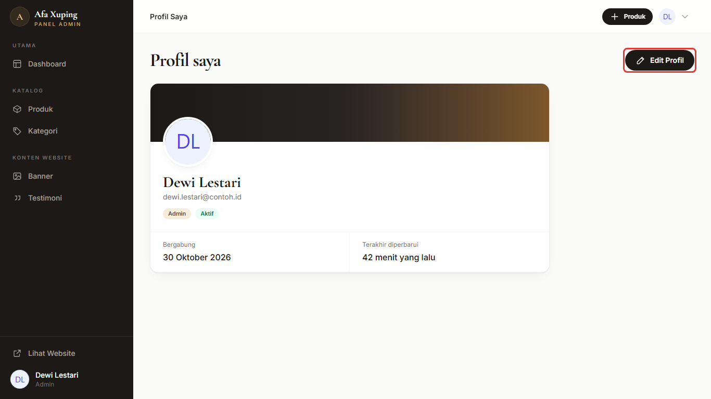

## 5.7 Mengubah Profil dan Kata Sandi

1. Klik **Edit Profil** pada halaman **Profil saya**.
2. Ubah **Nama** atau **Email** pada bagian **Data akun** bila perlu.
3. Klik area **Foto profil** untuk mengganti foto. Ukuran file paling besar 2 MB.
4. Untuk mengganti kata sandi, isi **Kata sandi saat ini**, **Kata sandi baru**, dan **Ulangi kata sandi baru**. Kosongkan ketiganya bila kata sandi tidak ingin diganti.
5. Klik **Simpan Profil**. Muncul pesan "Profil berhasil diperbarui."

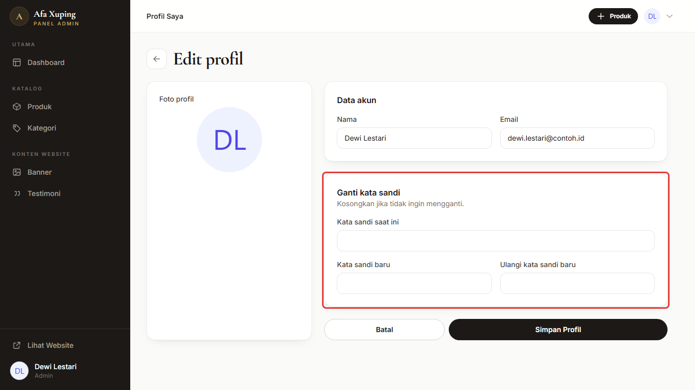

Kata sandi baru paling sedikit 8 karakter. Bila **Kata sandi saat ini** salah, muncul pesan "Kata sandi saat ini tidak sesuai."

# BAB 6 Panduan Owner dan Superadmin

Owner dan Superadmin memiliki semua fitur pada Bab 5, ditambah kelompok menu **Pengaturan** yang terdiri atas **Pengguna**, **Chatbot AI**, dan **Website & WhatsApp**. Bab ini hanya membahas fitur tambahan tersebut. Perbedaan antara Owner dan Superadmin dijelaskan pada subbab 6.2.

## 6.1 Mengelola Pengguna

### 6.1.1 Melihat Daftar Pengguna

Klik menu **Pengguna** untuk melihat semua akun beserta peran dan statusnya. Akun yang sedang login ditandai label **Anda** dan selalu berada di baris paling atas. Daftar dapat dicari berdasarkan nama atau email, serta disaring berdasarkan peran dan status.

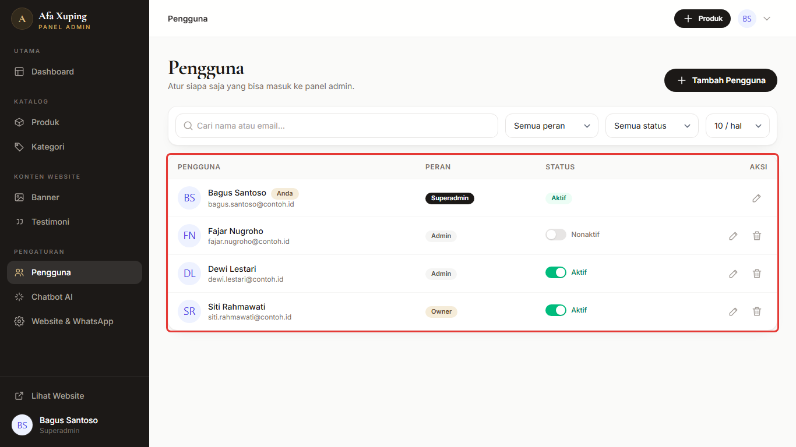

### 6.1.2 Menambah Pengguna

1. Klik **Tambah Pengguna**.
2. Isi **Nama** dan **Email**.
3. Isi **Kata sandi** dan **Ulangi kata sandi**.
4. Pilih **Peran**, yaitu **Admin** atau **Owner**.
5. Atur sakelar **Akun aktif**, lalu unggah **Foto profil** bila ada.
6. Klik **Buat Akun**. Muncul pesan "Pengguna berhasil ditambahkan."

Tabel: Isian Formulir Pengguna

| Kolom | Keterangan | Wajib |
|---|---|---|
| Foto profil | Gambar paling besar 2 MB. | Tidak |
| Nama | Nama pengguna, paling banyak 255 karakter. | Ya |
| Email | Dipakai untuk login. Tidak boleh sama dengan akun lain. | Ya |
| Kata sandi | Paling sedikit 8 karakter. Hanya diisi saat akun dibuat. | Ya |
| Ulangi kata sandi | Harus sama dengan kata sandi. | Ya |
| Peran | Admin mengelola katalog. Owner juga mengelola pengguna dan pengaturan. | Ya |
| Akun aktif | Akun nonaktif tidak dapat login. | Tidak |

Sampaikan email dan kata sandi kepada pengguna baru, lalu minta pengguna tersebut mengganti kata sandinya sendiri melalui subbab 5.7.

### 6.1.3 Mengaktifkan dan Menonaktifkan Akun

Akun yang dinonaktifkan tidak dapat login, tetapi datanya tetap tersimpan. Cara ini lebih aman daripada menghapus akun, misalnya untuk staf yang sedang tidak bertugas.

1. Klik sakelar pada kolom **Status** di baris akun.
2. Status berubah menjadi **Aktif** atau **Nonaktif** dan muncul pesan "Status pengguna berhasil diperbarui."

Status akun sendiri tidak dapat diubah.

### 6.1.4 Mengubah dan Menghapus Pengguna

Klik ikon pensil untuk mengubah nama, email, peran, status, atau foto profil, lalu simpan perubahan. Klik ikon tempat sampah untuk menghapus akun, lalu klik **Ya, lanjutkan** pada konfirmasi.

> **Perhatian:** Akun yang masih tercatat sebagai pembuat produk tidak dapat dihapus, karena produknya akan ikut terhapus. Website menampilkan pesan jumlah produk yang masih terkait. Nonaktifkan akun tersebut sebagai gantinya. Akun sendiri juga tidak dapat dihapus.

## 6.2 Perbedaan Owner dan Superadmin

Owner dan Superadmin memakai menu yang sama. Perbedaannya terletak pada akun yang boleh dikelola di menu **Pengguna**, seperti tercantum pada Tabel 6.2.

Tabel: Perbedaan Hak Owner dan Superadmin pada Menu Pengguna

| Tindakan | Owner | Superadmin |
|---|---|---|
| Melihat akun Superadmin di daftar | Tidak | Ya |
| Membuat akun Admin atau Owner | Ya | Ya |
| Mengubah, menonaktifkan, dan menghapus akun Admin | Ya | Ya |
| Mengubah, menonaktifkan, dan menghapus akun Owner lain | Tidak | Ya |
| Mengubah peran pengguna menjadi Superadmin | Tidak | Ya |

Bila Owner mencoba mengubah akun di luar haknya, muncul pesan "Tidak memiliki izin." Gambar 6.4 memperlihatkan daftar pengguna saat login sebagai Owner. Akun Superadmin tidak tampil, dan akun Owner yang sedang login tidak memiliki ikon hapus.

> **Catatan:** Akun Superadmin baru tidak dapat dibuat langsung dari formulir **Tambah Pengguna**. Superadmin membuat akun dengan peran Owner atau Admin terlebih dahulu, lalu mengubah perannya menjadi Superadmin melalui formulir edit.

## 6.3 Memantau Chatbot

Menu **Chatbot AI** menampilkan pemakaian chatbot Tanya Afa. Empat kotak di bagian atas memuat **Pesan hari ini** beserta kuota yang terpakai, **Pesan bulan ini**, **Perkiraan biaya**, dan **Rata-rata token** per pesan.

Bagian **Riwayat percakapan** memuat pertanyaan pengunjung, jawaban chatbot, status (misalnya **Dijawab**), dan jumlah produk yang direkomendasikan. Riwayat ini berguna untuk mengetahui produk atau informasi yang sering ditanyakan. Data pribadi pengunjung tidak disimpan, dan riwayat dihapus otomatis setelah 30 hari. Klik **Pengaturan** di kanan atas untuk membuka tab **Chatbot AI** pada pengaturan website.

> **Catatan:** Perkiraan biaya dihitung dari jumlah token dan hanya sebagai gambaran. Tagihan resmi tetap mengacu pada Google Cloud Billing.

## 6.4 Pengaturan Website dan WhatsApp

Menu **Website & WhatsApp** mengatur teks, gambar, dan kontak yang tampil di halaman publik. Pengaturan dibagi menjadi lima tab. Langkah umumnya sama untuk semua tab.

1. Klik menu **Website & WhatsApp**.
2. Klik tab yang akan diubah.
3. Ubah isian yang diperlukan.
4. Klik **Simpan Pengaturan**. Muncul pesan "Pengaturan berhasil diperbarui."

Tombol **Lihat website** di kanan atas membuka website di tab baru untuk memeriksa hasil perubahan.

### 6.4.1 Tab Umum

Tab **Umum** berisi **Nama toko**, **Teks hak cipta (footer)**, dan **Logo**. Logo sebaiknya berformat PNG transparan dengan tinggi sekitar 120 piksel. Bila logo tidak diunggah, nama toko ditampilkan sebagai teks.

### 6.4.2 Tab WhatsApp & Kontak

Tab **WhatsApp & Kontak** menentukan nomor tujuan semua tombol pesan di website. Kotak **Pratinjau pesan** di sisi kanan menampilkan contoh pesan yang akan diterima admin.

Tabel: Isian Tab WhatsApp & Kontak

| Kolom | Keterangan | Wajib |
|---|---|---|
| Nomor WhatsApp Business | Nomor tujuan pesanan. Boleh diawali 0 atau 62 dan hanya berisi angka. | Tidak, tetapi tombol pesan tidak berfungsi bila kosong |
| Kalimat pembuka pesan | Kalimat pertama pada setiap pesan pesanan. | Tidak |
| Email | Email kontak toko yang tampil di website. | Tidak |
| Jam layanan | Contoh: Senin sampai Sabtu, 09.00 sampai 17.00 WIB. | Tidak |
| Alamat | Alamat toko. | Tidak |
| Link embed Google Maps | Kode atau link dari menu Bagikan, lalu Sematkan peta di Google Maps. | Tidak |

Untuk mengisi **Link embed Google Maps**, buka Google Maps, cari lokasi toko, klik **Bagikan**, pilih **Sematkan peta**, lalu klik **Salin HTML** dan tempel hasilnya pada kolom tersebut. Bila yang ditempel bukan kode sematan peta, muncul pesan "Link Google Maps belum benar."

### 6.4.3 Tab Beranda & Tentang

Tab **Beranda & Tentang** berisi dua bagian. Bagian **Hero beranda** memuat **Judul utama**, **Subjudul**, dan **Gambar hero** yang tampil bila belum ada banner aktif. Bagian **Halaman Tentang Kami** memuat **Judul**, **Cerita toko**, dan **Foto** untuk halaman Tentang Kami. Baris baru pada **Cerita toko** tampil sebagai paragraf baru.

### 6.4.4 Tab Sosial & SEO

Tab **Sosial & SEO** memuat link **Instagram**, **TikTok**, **Facebook**, dan **Shopee** yang tampil di bagian bawah website. Tulis setiap link secara lengkap, diawali "https://". Link yang dikosongkan tidak ditampilkan ikonnya.

Kolom **Deskripsi untuk Google** berisi kalimat singkat yang muncul di hasil pencarian Google dan di bagian bawah website, idealnya 120 sampai 160 karakter dan paling banyak 300 karakter. **Gambar saat link dibagikan** tampil ketika link website dibagikan ke WhatsApp atau Facebook, dengan ukuran yang disarankan 1200 × 630 piksel. Bila kosong, website memakai gambar hero. Halaman produk selalu memakai foto produknya sendiri.

### 6.4.5 Tab Chatbot AI

Tab **Chatbot AI** mengatur asisten Tanya Afa.

Tabel: Isian Tab Chatbot AI

| Kolom | Keterangan | Wajib |
|---|---|---|
| Tampilkan chatbot di website | Mematikan sakelar ini menyembunyikan tombol Tanya Afa dari website. | Tidak |
| Batas pesan per hari (semua pengunjung) | Jumlah pesan maksimal dari seluruh pengunjung dalam satu hari, 0 sampai 5.000. | Tidak |
| Batas pesan per pengunjung per hari | Jumlah pesan maksimal dari satu pengunjung dalam satu hari, 0 sampai 200. | Tidak |

Bila batas tercapai, chatbot menyarankan pengunjung menghubungi admin melalui WhatsApp. Tombol **Buka riwayat chatbot** membuka halaman yang dijelaskan pada subbab 6.3.

> **Perhatian:** Setiap pesan chatbot menimbulkan biaya pemakaian Google AI. Atur batas pesan sesuai anggaran, dan pasang budget alert di Google Cloud Billing sebagai pengaman tambahan.

# BAB 7 Pemecahan Masalah

Tabel 7.1 memuat masalah yang mungkin ditemui beserta penyebab dan cara mengatasinya. Pesan dalam tanda kutip ditulis persis seperti yang tampil di layar.

Tabel: Pemecahan Masalah

| Masalah | Kemungkinan Penyebab | Solusi |
|---|---|---|
| Muncul pesan "Email atau password yang Anda masukkan salah." saat login | Email atau kata sandi salah ketik, atau akun sedang dinonaktifkan. | Periksa kembali email dan kata sandi. Bila tetap gagal, minta Owner atau Superadmin memeriksa status akun di menu Pengguna. |
| Halaman login menolak percobaan dan menampilkan galat 429 | Login gagal lebih dari 10 kali dalam satu menit. | Tunggu satu menit, lalu login kembali. |
| Lupa kata sandi | Website tidak memiliki fitur atur ulang kata sandi melalui email. | Hubungi bantuan teknis pada Bab 8. |
| Muncul pesan "Kata sandi saat ini tidak sesuai." | Kata sandi lama yang diisi di formulir Edit profil salah. | Isi kata sandi yang dipakai untuk login saat ini. |
| Muncul pesan "Konfirmasi kata sandi tidak cocok." | Isi kolom kata sandi baru dan kolom ulangi kata sandi berbeda. | Ketik ulang kedua kolom dengan isi yang sama. |
| Muncul pesan "Harga coret harus lebih besar dari harga jual." | Harga coret lebih kecil atau sama dengan harga jual. | Naikkan harga coret atau kosongkan kolom tersebut. |
| Muncul pesan "Ukuran setiap foto maksimal 5 MB." | Foto produk terlalu besar. | Perkecil foto atau kirim ulang foto dari ponsel dengan kualitas standar. |
| Muncul pesan "Gagal menyimpan stok" | Koneksi internet terputus atau sesi login sudah berakhir. | Muat ulang halaman, login kembali bila diminta, lalu ulangi pengisian stok. |
| Muncul pesan "Nama sudah dipakai." saat menyimpan kategori | Sudah ada kategori dengan nama yang sama. | Gunakan nama lain atau ubah kategori yang sudah ada. |
| Muncul pesan "Kategori tidak dapat dihapus karena masih memiliki produk." | Kategori masih berisi produk. | Pindahkan produk ke kategori lain atau hapus produknya terlebih dahulu. |
| Muncul pesan link harus diawali "/" atau "https://" pada formulir banner | Isi Link tombol tidak diawali "/" atau "https://". | Tulis alamat lengkap, misalnya /products atau https://shopee.co.id/... |
| Banner terpotong di ponsel | Banner belum memiliki gambar khusus ponsel. | Unggah gambar potret 1080 × 1350 piksel pada kolom Gambar HP. |
| Muncul pesan "Email sudah dipakai." | Email sudah dipakai akun lain. | Gunakan email lain. |
| Muncul pesan "Tidak memiliki izin." | Owner mencoba mengelola akun Owner lain atau Superadmin. | Minta Superadmin melakukan perubahan tersebut. |
| Akun tidak dapat dihapus karena masih memiliki produk | Akun tercatat sebagai pembuat produk. | Nonaktifkan akun melalui sakelar status. |
| Muncul pesan "Nomor WhatsApp hanya boleh berisi angka." | Nomor WhatsApp berisi huruf atau tanda baca selain +, -, dan spasi. | Tulis nomor dengan angka saja, misalnya 081234567890. |
| Muncul pesan "Link Google Maps belum benar." | Yang ditempel bukan kode sematan peta. | Ikuti langkah pengisian pada subbab 6.4.2. |
| Pengunjung mendapat pesan "Nomor WhatsApp belum diatur" | Nomor WhatsApp Business pada pengaturan masih kosong. | Isi nomor pada tab WhatsApp & Kontak. |
| Tombol pesan tidak bereaksi dan muncul pesan untuk memilih ukuran atau warna | Produk memiliki varian yang belum dipilih. | Klik pilihan warna dan ukuran terlebih dahulu. |
| Muncul pesan "Gagal memuat data, coba lagi." di katalog | Koneksi internet terputus saat filter diubah. | Periksa koneksi, lalu ubah filter kembali atau muat ulang halaman. |
| Tanya Afa menjawab "Maaf Kak, Afa sedang istirahat." | Chatbot dimatikan di pengaturan atau kunci layanan Google AI belum terpasang. | Nyalakan sakelar Tampilkan chatbot di website. Bila tetap muncul, hubungi bantuan teknis. |
| Tanya Afa menjawab bahwa kuota hari ini sudah habis | Batas pesan harian tercapai. | Tunggu hari berikutnya atau naikkan batas pada tab Chatbot AI. |
| Tanya Afa menjawab "Maaf Kak, Afa lagi kesulitan menjawab." | Layanan Google AI sedang gangguan atau tidak dapat dihubungi. | Coba beberapa saat lagi. Bila berlangsung lama, hubungi bantuan teknis. |
| Perubahan di panel admin belum tampil di website | Browser masih menampilkan halaman lama. | Muat ulang halaman website atau tekan Ctrl + F5. |

# BAB 8 Penutup

Panduan ini menjelaskan penggunaan Website Afa Xuping Accessories sesuai versi yang diserahkan pada Oktober 2026. Bila website mendapat pembaruan fitur, panduan ini akan diperbarui dan dicatat pada Riwayat Revisi Dokumen.

Pertanyaan, kendala teknis, atau permintaan perubahan dapat disampaikan kepada bantuan teknis berikut.

Tabel: Kontak Bantuan Teknis

| Keterangan | Kontak |
|---|---|
| Nama | Dony Kurniawan |
| Email | donykurniawan1298@gmail.com |
| WhatsApp | 0821-3323-7136 |
